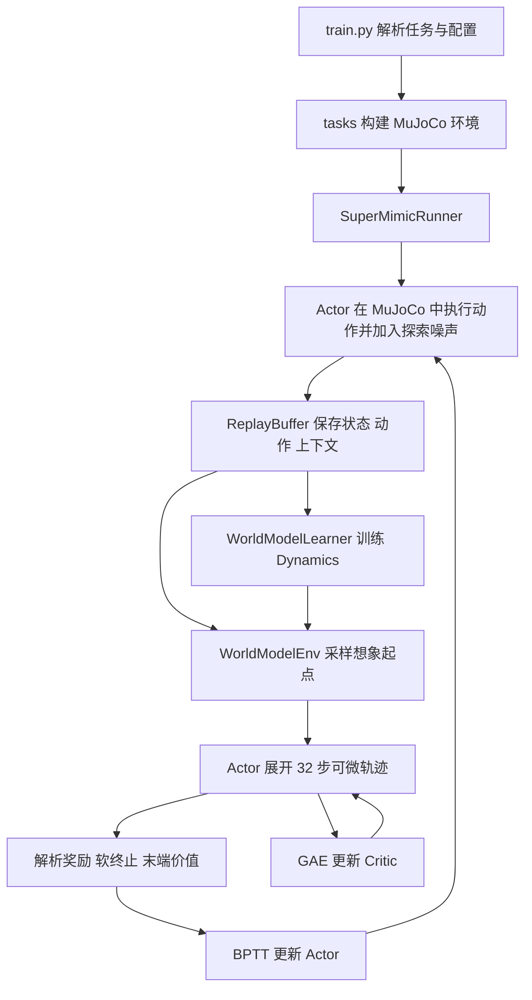

# SuperMimic 代码与论文对照讲解

本文对应 `/data2t/haowenYan/projects/supermimic_ws/supermimic` 当前工作区，覆盖原有的 63 个受 Git 管理文件：35 个源码 Python 文件、20 个测试 Python 文件和 8 个项目文件。源码中共有 49 个类。最后的符号索引列出每个 Python 文件的全部类、类方法和顶层函数，方便定位。

阅读主线是：**在 MuJoCo 中采样 → 用采样数据学习动力学 → 在学到的动力学中展开轨迹 → 反向传播更新控制策略**。先理解这条主线，再看状态表示和部署工具，能够避免被运动学与配置代码淹没。

## 论文方法与代码入口

论文的三阶段循环对应 `SuperMimicRunner.step()`、`WorldModelLearner.update()`、`ActorCriticPolicyLearner.update()`。世界模型提供可微状态转移，策略用短轨迹的回报梯度更新；critic 补充轨迹末端以后的价值。对应论文第 3 节、图 2、式 1—3 和附录 D。[论文原文](https://arxiv.org/pdf/2610.28480)

| 论文概念 | 当前代码 | 理解方式 |
|---|---|---|
| 动力学模型 | `models.Dynamics` 与 `representations.StateRepresentation` | 神经网络给出速度增量，表示层负责解析积分 |
| 模型监督目标，式 1 | `learners/wm_learner.py` | 从 replay 的连续状态窗口计算多步状态误差 |
| 策略目标，式 2 | `BpttPolicyLearner._train_batch()` 与 AC 的 `_bootstrap()` | 累加可微奖励与生存权重，再加末端价值 |
| 价值目标，式 3 | `gae_returns()` 与 `_fit_critic()` | 沿想象轨迹倒推固定目标，拟合 critic |
| 仿真上下文 | `sim_context.py` | 把当前摩擦、质心和编码器偏差提供给模型 |
| 多目标接口 | `MultiEncoderAE`、`TaskSpec` | 不同 goal 编码器共用动作 decoder |
| 基于回报的重置 | `ReturnSampler` | 增加低回报动作片段的练习频率 |

这张表是根据论文与本地调用关系建立的对应关系；具体实现行为以下文源码解释为准。



注意图中的 MuJoCo 轨迹用于提供数据，策略学习的反向传播发生在 `WorldModelEnv` 这条支路中。

## 当前默认配置与论文实验的差别

论文描述使用本体感知的 10 帧历史、多接口各自的 critic，以及 Adam；附录还给出了训练步数与学习率调度。[论文附录 A—D](https://arxiv.org/pdf/2610.28480#page=13)

本地实现需要单独检查下面这些行为，不能认为运行 README 命令就完整复现论文的全部实验设置：

| 项目 | 当前代码行为 | 源码入口 |
|---|---|---|
| actor 观测 | `actor_obs="rep_state"`，默认直接读取模型状态表示 | `BaseRunnerCfg` |
| 历史长度 | `history_length=1`；长度大于 1 要求 `actor_obs="proprio"` | `BaseRunnerCfg`、`build_world_model()` |
| 默认策略学习器 | Actor-Critic，想象长度 32，γ=0.99，λ=0.95 | `SuperMimicRunnerCfg.policy` |
| 纯 BPTT 选项 | 没有末端 critic，默认 γ=1 | `BpttPolicyLearnerCfg` |
| 模型窗口 | 配置 `horizon=8` 取 8 个状态记录，当前循环实际预测并监督 7 个转移 | `WorldModelLearner._rollout()` |
| 优化器 | 中间 Linear 权重用 Muon，其余参数用 Adam | `build_optimizers()` |
| critic 数量 | 主 runner 构建一个共享 critic | `SuperMimicRunner._init_policy()` |
| velocity 接口 | 已实现速度 goal 编码器，但各 slot 均使用动作跟踪奖励 | `TaskSpec`、`MultiTaskWorldModelEnv` |
| decoder 梯度 | 主回报反向传播经过共享 decoder；latent BC 分支单独限制梯度 | `MultiEncoderAE.forward()`、`_compute_aux_loss()` |
| 默认接口分配 | motion=1.0、velocity=0.0，默认没有速度接口训练样本 | `SuperMimicRunnerCfg.slot_mix` |
| 迭代次数 | 主 runner 默认 1,000,000 次 | `SuperMimicRunnerCfg.max_iterations` |
| 学习率 | 当前主循环未实现 cosine 学习率调度 | `SuperMimicRunner.run()` |
| 默认动作数据 | `lafan_run1_subject5` W&B artifact | `scripts/train.py:TrainConfig` |

其中“8 个状态只产生 7 个转移”来自代码中 `range(actions.shape[1] - 1)`，是读实现时需要记住的计数方式。

## 状态与张量先看懂

### 三种状态和两种目标

| 名称 | 内容 | 为什么需要 |
|---|---|---|
| `full_state` | 仿真记录的完整物理状态 | 存 replay，提供监督真值 |
| `rep_state` | 转成根坐标系等适合网络学习的状态 | 输入 Dynamics，也可作为 actor 观测 |
| `aux_state` | 根位置 3 维与根四元数 4 维 | 保存表示中省去的全局位姿，执行积分和重建 |
| `wm_goal` | 参考关节序列和相对根位置、相对根朝向 | 提供模型环境与 critic 使用的目标信息 |
| `actor_goal` | 从 `wm_goal` 去掉相对根位置 | 提供给 motion encoder 的目标 |
| `sim_ctx` | 归一化的仿真随机化参数 | 告诉模型当前使用哪组物理/传感器参数 |

`rep_state` 不是通过 VAE 学出的隐变量，而是人工定义的物理坐标表示。`MultiEncoderAE` 的 latent 则是目标编码器学到的 32 维向量，两者作用完全不同。

### GenCoord 的维度

设 N 为关节数，G1 通常 N=29：

```text
full_state = [root_pos(3), root_quat(4), q(N), v_world(3), w_world(3), qdot(N)]
维度       = 13 + 2N = 71

rep_state  = [height(1), gravity_body(3), v_body(3), w_body(3), q(N), qdot(N)]
维度       = 10 + 2N = 68

prediction = [delta_v_body(3), delta_w_body(3), delta_qdot(N)]
维度       = 6 + N = 35

aux_state  = [root_pos(3), root_quat(4)]，共 7 维
```

神经网络预测的是一步速度增量，表示层再更新位置、姿态与关节角。不要把网络输出直接当作下一时刻的完整状态或未经积分的加速度。

### MaxCoord 的维度

设 B 为被跟踪的刚体数量，这里 B 是 body 数，不是 batch size：

```text
full_state = [body_pos(3B), body_quat(4B), body_vel(3B), body_avel(3B)]
维度       = 13B

rep_state  = [local_pos(3B), local_rot6d(6B), local_vel(3B), local_avel(3B),
              root_height(1), gravity_body(3)]
维度       = 15B + 4

prediction = [delta_body_vel(3B), delta_body_avel(3B)]
维度       = 6B
```

MaxCoord 的各刚体状态直接进入模型。需要关节角和关节速度时，再通过 `AnalyticIK` 求解。它与 GenCoord 的根本区别是“按关节描述机器人”和“按刚体描述机器人”。

### G1 的观测与目标示例

在 N=29、默认三类上下文都开启时：

| 张量 | 维度/形状 |
|---|---|
| 一帧 proprio | 重力3 + IMU角速度3 + 关节角29 + 关节速度29 + 前动作29 = 93 |
| actor 历史 | `(batch, history_length, obs_dim)`；最新帧在最后 |
| motion 目标内容 | 10 帧 × 每帧关节角/关节速度58 = 580 |
| 相对根位置窗口 | 10 × 3 = 30 |
| 相对根朝向窗口 | 10 × 6 = 60 |
| `wm_goal` | 580 + 30 + 60 = 670 |
| `actor_goal` | 580 + 60 = 640 |
| `sim_ctx` | 摩擦1 + 质心3 + 编码器偏差29 = 33 |
| GenCoord critic 输入 | `rep_state68 + wm_goal670 + sim_ctx33 = 771` |

目标窗口的 `NUM_GOAL_FRAMES=10`、`GOAL_FRAME_STRIDE=5`。窗口包括当前帧，再按 5 帧间距取未来目标；按代码注释的 50 Hz 控制频率，覆盖约 0.9 秒。历史窗口则回看过去，两者不要混淆。

## 核心文件逐项讲解

以下路径均相对于仓库根目录。源码链接从本文所在的 `docs` 目录指向对应文件。

### src/supermimic/models.py

[打开源码](../src/supermimic/models.py)

这个文件定义可学习的网络结构，不负责完整训练调度。

- `_CudaGraphNormalization`：继承 rsl_rl 的经验归一化。重写 `update()`，用原地复制保留标准差 buffer 的地址，避免 CUDA Graph 捕获后还引用旧地址。
- `Dynamics`：动力学网络。`proc()` 把原始 action 按 scale/offset 转成关节命令；`forward()` 拼接归一化状态、处理后的动作与上下文，经 MLP 产生 prediction，再调用表示层的 `apply_prediction()` 返回 `(next_aux, next_rep)`。
- `MultiEncoderAE`：多个任务 goal encoder 加一个共享动作 decoder。`set_slot_mix()` 设置 batch 中各任务的比例，`slot_ranges()` 算连续区间；`forward()` 按 slot 选择 encoder，再拼接 `tanh(z)` 与归一化历史，输出动作。`_compute_aux_loss()` 用 motion latent 约束其他 encoder；目标 latent 停梯度，辅助损失不会更新 anchor encoder 或 decoder。`update_normalization()` 用真实采样输入更新统计量。

`build_mlp()` 使用 `Linear → LayerNorm → GELU` 的重复块，最后接输出 Linear。`MultiEncoderAE` 虽然名字带 AE，当前训练目标不是重建输入观测，也没有 VAE 的分布采样与 KL 项。

### src/supermimic/representations.py

[打开源码](../src/supermimic/representations.py)

这是物理语义最集中的文件：它定义状态如何表示、网络输出如何积分、观测如何合成、奖励如何得到。

- `StateRepresentation`：共同接口。`represent()`、`extract_aux_state()` 处理状态拆分；`apply_prediction()` 定义转移；`joint_state()` 与 `world_frame_bodies()` 为观测和奖励提供关节/刚体信息；`compute_actor_sensor()`、`build_actor_obs()` 组装策略观测；`compute_wm_goal()` 生成两个版本的 goal；`compute_wm_reward_from_reference()` 连接到解析奖励；`loss_blocks()` 定义监督误差通道。
- `GenCoordRepresentation`：关节坐标实现。`bind()` 取得 mjlab 的可微正运动学对象。`apply_prediction()` 将根速度和关节速度增量作解析积分，再从更新后的根姿态推导重力方向。`world_frame_bodies()` 用 FK 把关节状态转为全身刚体状态。`loss_blocks()` 监督根位姿、关节角和关节速度。
- `MaxCoordRepresentation`：刚体坐标实现。`bind()` 建立解析 IK，并定位编码器偏差在上下文中的列。`apply_prediction()` 更新每个刚体速度，在旧根系中积分，再换到新根系。`joint_state()` 调用 IK；`compute_wm_obs()` 从刚体姿态恢复可供策略使用的传感器信息。`loss_blocks()` 监督根位姿和非根刚体位置、旋转、速度及角速度。

顶层函数分为三组：`create_representation()` 负责工厂创建；`goal_window_indices()`、`motion_goal_window()`、`motion_anchor_window()`、`assemble_anchor_window()` 负责跨时间目标；`actor_goal_dim()`、`extract_actor_goal()`、`term_major_to_temporal()` 负责目标裁剪与历史布局转换。

几个细节容易看错：MaxCoord 的 `up_dir` 字段实际保存世界向下重力在根系中的方向；`local_vel` 是把绝对速度旋转到根系，不是先减根速度得到的相对速度。MaxCoord 当前没有把逐刚体预测重新投影到完整关节约束流形，解析 IK 用于恢复关节信息，不会重写全部刚体预测位置。另外，两种表示的传感器合成实现有区别：当前 GenCoord 的 `compute_wm_obs()` 没有使用 sim_ctx 加编码器偏差，MaxCoord 则显式从上下文恢复并加入该偏差。

### src/supermimic/sim_context.py

[打开源码](../src/supermimic/sim_context.py)

这个文件读取每个仿真环境实际使用的随机化参数。它不负责采样或施加随机化，随机化本身由 mjlab 的事件系统完成。

- `SimContextSpec`：单类上下文的抽象契约。`bind()` 解析索引和取值范围，`read()` 读取原始值；`_global_entity_id()` 将机器人局部索引转成 MuJoCo 全局索引。
- `FootFrictionSpec`：读取匹配脚部 geom 的切向摩擦，1 维。这里依赖脚部摩擦事件在同一环境中共享随机值的约定。
- `CoMOffsetSpec`：读取指定躯干 body 的质心位置参数，3 维。
- `EncoderBiasSpec`：读取关节编码器偏差，维度由机器人关节数决定。
- `SimContext`：`from_env()` 根据启用的事件选择 spec；`read()` 按固定列顺序拼接并归一化；`find()` 查询某类参数所在的 slice；`denormalize()` 恢复物理值。

`_mean_scale()` 避免取值范围极窄时除以极小数放大浮点噪声。`SimContext` 继承 `nn.Module` 是为了保存均值和尺度等 buffer，并不是另一个学习网络。

### src/supermimic/replay_buffer.py

[打开源码](../src/supermimic/replay_buffer.py)

- `FieldSpec`：一个 buffer 字段的维度和 dtype 描述。`dim=0` 表示标量字段；`shape()` 生成存储形状。
- `ReplayBuffer`：按环境分层的环形时间缓冲。`insert()` 在每个环境的当前槽位写入一条记录；`sample()` 采样连续、内部不跨 episode 边界的窗口；`sample_causal()` 以随机当前帧为末端取历史，历史不够时重复本 episode 最早可用帧，并返回 padding mask。

主 runner 的 schema 是 `state/action/prev_action/motion_time/terminated/truncated/sim_ctx`，在 proprio 多帧历史模式下增加 `actor_obs`。这里没有把 reward 作为世界模型监督标签存进去；模型环境的 reward 是解析计算的。

存储张量通常为 `(num_envs, buffer_size, feature_dim)`。`num_transitions` 统计每个环境已经填充的时间槽数量，上限是 `buffer_size`，不等于所有并行环境记录数之和。

## envs 目录

### src/supermimic/envs/world_model_env.py

[打开源码](../src/supermimic/envs/world_model_env.py)

`WorldModelEnv` 是可微环境基类，给策略学习器一个类似 `reset/step/get_observations` 的接口，内部推进神经网络状态。

`reset()` 从 replay 快照恢复状态、前动作、上下文和参考动作时间；`sample_initial_states()` 与 `_warmstart_past_sensors()` 为历史模式取真实同 episode 前驱；`step()` 调用 `_wm_step()`，更新状态、动作历史和目标，再返回下一观测、奖励与软终止概率。

`_wm_step()` 将 Dynamics、下一时刻关节恢复、终止判断、跟踪奖励打包在一起。奖励和终止用更新后状态对比当前缓存的参考帧，然后才推进目标时间，避免真实仿真与模型环境错一帧。

`_compute_term_prob()` 将高度偏差和重力方向 z 分量偏差分别除以真实环境配置阈值，取较大值后经过 sigmoid。阈值从 `env.cfg.terminations` 读取，不在这里写死。它是解析的软终止，没有独立终止网络或 BCE 训练项。

`_critic_obs()` 拼接 `[rep_state, wm_goal, sim_ctx]`，critic 使用的信息比可部署 actor 更多。`_compute_commands()` 推进参考帧并在 clip 末端钳制，防止想象轨迹跨入下一条拼接动作。

### src/supermimic/envs/motion_tracking_env.py

[打开源码](../src/supermimic/envs/motion_tracking_env.py)

`MotionTrackingEnv` 只实现单一 motion 接口的 `get_observations()`，输出扁平 `actor` 与 `critic` 字段。它复用基类的动力学、奖励和历史，在 PPO 支路中使用。文件很短，是因为共享逻辑都放在基类里。

### src/supermimic/envs/multi_task_world_model_env.py

[打开源码](../src/supermimic/envs/multi_task_world_model_env.py)

`MultiTaskWorldModelEnv` 为多编码器策略输出 `history`、`goal_motion`、`goal_velocity` 等字段，以及 `critic`。`_build_task_goals()` 复用 motion goal，再根据每个 TaskSpec 生成其他目标；`get_observations()` 将它们交给统一 TensorDict 构造函数。

所有目标字段都保持完整 batch，actor 自己根据 slot 截取。这个类仍共享动作跟踪奖励，所谓多任务首先表示不同的目标输入接口。

### src/supermimic/envs/__init__.py

包说明文件，没有类或运行逻辑。

## learners 目录

### src/supermimic/learners/wm_learner.py

[打开源码](../src/supermimic/learners/wm_learner.py)

- `WorldModelLearnerCfg`：模型学习率、每次更新的 batch 数、batch size、窗口长度，以及各误差组允许的 nominal error。
- `WorldModelLearner`：监督训练 Dynamics。`update_normalization()` 用新采样状态和处理后的动作更新归一化；`update()` 收集固定形状 batch；`_update_from()` 从窗口第一帧初始化，调用 `_rollout()` 按记录动作自回归推进，再计算损失、反向传播。

`_compute_losses()` 按表示层提供的 `loss_blocks()` 比较预测与真值。每组权重是 `1/nominal_error²`，再按通道数汇总，因此并非不加区分地对所有原始状态做 MSE。GenCoord 会监督解析积分得到的根位姿与关节状态；MaxCoord 会监督根位姿和非根刚体通道。

这条路径只训练动力学。观测、奖励、终止采用解析构造，因此当前实现没有额外的 reward、observation、termination 预测头损失。

### src/supermimic/learners/policy_learner.py

[打开源码](../src/supermimic/learners/policy_learner.py)

- `BpttPolicyLearnerCfg`：学习率、batch 数、batch size、采集动作噪声、想象 horizon、折扣、生存权重开关和梯度裁剪。
- `ActorCriticPolicyLearnerCfg`：继承上面的配置，默认 γ=0.99，并增加 λ=0.95。
- `BpttPolicyLearner`：`update()` 将世界模型设为 eval，并冻结其参数；`_train_batch()` 展开轨迹，累加 `gamma**t * survival * reward`，加辅助 latent loss 后更新 actor。基类 `_bootstrap()` 返回 0，`_fit_critic()` 不做事。
- `ActorCriticPolicyLearner`：重写 `_bootstrap()`，加入末端 critic 价值；重写 `_fit_critic()`，用 GAE 目标训练 critic，当前为 5 轮、每轮 4 个 minibatch，并限制价值目标不超过理论上界。

`gae_returns()` 支持概率形式的 done，使用 `(1-term_prob)` 连续地衰减后续回报。

最重要的梯度区别是：冻结世界模型的参数，仍然允许计算输出对状态和动作的导数。因此“冻结世界模型”不能改成把想象轨迹整个包进 `no_grad()`。同理，bootstrap 时冻结 critic 参数，仍需保留其对末端状态的导数。

策略目标可以按当前代码写成：

```text
survival_0 = 1
survival_(t+1) = survival_t * (1 - term_prob_(t+1))
return = sum_t gamma^t * survival_t * reward_(t+1)
       + gamma^H * survival_H * V(state_H)
actor_loss = mean(-return + latent_aux_loss)
```

critic 训练使用 detach 后的轨迹和固定目标，因此不会反过来把 critic 拟合误差传播到整条动力学轨迹。

### src/supermimic/learners/learner_utils.py

[打开源码](../src/supermimic/learners/learner_utils.py)

`build_optimizers()` 为 Sequential 中首尾之外的 Linear 权重建立 Muon，为其余参数建立可捕获的 fused Adam。`_optimize_step()` 统一清梯度、反向传播、范数裁剪、逐元素裁剪和 optimizer step。

`graph_state()` 收集参数、buffer 和优化器状态的地址相关张量。`_identity()` 检查地址，`_capture_stream_and_pool()` 提供共享 stream/pool。

`CapturedUpdate` 将一个完整更新过程先预热，再捕获为 CUDA Graph 并重放；CPU 上直接调用原函数。它要求形状固定、需要读的张量地址稳定，并检查是否有已捕获张量被重新分配。这解释了模型中为什么专门处理 normalization buffer 的原地更新。

### src/supermimic/learners/__init__.py

空包标记，没有类。

## runners 目录

### src/supermimic/runners/supermimic_runner.py

[打开源码](../src/supermimic/runners/supermimic_runner.py)

这个文件是主训练流程的总装配点，优先阅读。

- `BaseRunnerCfg`：共享配置，包括表示类型、actor 观测、历史长度、replay 容量、Dynamics 宽度与模型学习配置。
- `SuperMimicRunnerCfg`：增加 actor/critic 宽度、latent、接口 slot 比例、策略学习器选项、重置采样和训练频率配置。
- `WorldModel`：保存 representation、Dynamics、SimContext 及维度信息的 dataclass。`bundle()` 和 `load_bundle()` 保存/恢复 Dynamics 与上下文 buffer；表示层按配置和环境重新创建。
- `Ratio`：将实数频率转成整数次更新，让模型学习与环境采集不必每步一一对应。
- `BaseRunner`：共同初始化与采样设施。`_init_common()` 创建模型和 replay；`_buffer_schema()` 定义记录字段；`_step_and_store()` 执行真实环境动作并保存动作执行前的状态；`_seed_sim_history()`、`_collection_history()`、`_advance_sim_history()` 维护真实传感器历史；`_flush_normalization()` 在采集推理模式之外更新统计量；其余方法处理日志、W&B 与清理。
- `SuperMimicRunner`：主算法。`_init_policy()` 创建多编码器 actor、一个 critic、模型环境和 learner；`_build_sim_obs_td()` 为真实采样组装同格式输入；`_configure_reset_sampling()` 安装 ReturnSampler；`step()` 执行带噪动作、存数据并更新 reset 分布；`run()` 调度模型训练、策略训练、日志与 checkpoint。

顶层 `build_world_model()` 从真实环境推断维度，建立状态表示、上下文和 Dynamics；`build_actor()` 按配置建立 MultiEncoderAE；`load_wandb_checkpoint()` 用已有 run 的世界模型进行初始化，不能理解为恢复整套训练状态。

`run()` 中每次外层循环采一个真实环境步，再由 Ratio 决定训练次数。默认计算为：

```text
4096 / 10 / 2048 / 8 * replay_ratio16 = 0.4
```

也就是平均每 2.5 个采集步触发一轮更新；一轮包含 10 个世界模型 batch，再调用一次策略 learner。它不是每个外层 step 固定做 16 次 actor 更新。

默认 checkpoint 为 `world_model.pt`、`actor.pt`，存在 critic 时另存 `critic.pt`；W&B 上传通过单线程 executor 调度。只有 proprio 模式且动作数据总帧数不超过 15,000 时，当前主循环才自动导出 ONNX。checkpoint 不包含优化器、replay 和完整迭代状态，因此不应当作精确断点续训快照。

### src/supermimic/runners/reset_sampling.py

[打开源码](../src/supermimic/runners/reset_sampling.py)

- `ReturnSamplerCfg`：配置折扣、累计步数、估值记忆长度、softmax 强度，以及 explore/keep 比例。
- `ReturnSampler`：记录动作时间 bin 的实际回报。`record()` 缓存轨迹片段；`_returns()` 区分失败、clip 结束和超时进行 bootstrap；`_update()` 把同环境同 episode 同 bin 的访问先合为样本，再更新 bin 价值；`_distribution()` 混合均匀、低回报重点采样、历史练习保留三项。

默认分配为均匀 50%、当前重点 40%、历史保留 10%。历史保留的 `effort` 累加的是重点采样概率的平方。它是参考动作初始状态采样器，不是给 replay 按 TD error 排序的 prioritized replay。

### src/supermimic/runners/ppo_runner.py

[打开源码](../src/supermimic/runners/ppo_runner.py)

- `PpoRunnerCfg`：真实采样步数、想象 rollout 长度、PPO clipping、KL、熵系数和网络尺寸等。
- `PpoRunner`：复用 BaseRunner 的世界模型与 replay。`collect_data()` 采真实数据，`imagine()` 在模型环境中填 RolloutStorage 并调用 PPO 更新，`run()` 执行真实采集→模型训练→模型内 PPO 的循环。

它可以用来理解“同样有世界模型时，通过回报反向传播与通过 PPO 更新策略的区别”。这里 actor 是带高斯分布的 rsl_rl MLP，不是主路径的 MultiEncoderAE。保存的 `actor.pt` 是含 actor/critic 两个字典项的格式，而现有 `play.py` 按主路径 MultiEncoderAE 权重加载，两种产物不能直接混用。

### src/supermimic/runners/run_config.py

[打开源码](../src/supermimic/runners/run_config.py)

没有类。`load_runner_cfg()` 从 W&B JSON 重建 SuperMimicRunnerCfg；`_rebuild()` 递归恢复 dataclass；`_coerce()` 恢复 tuple 与配置联合类型；`_pick_variant()` 根据字段重合确定 BPTT/AC 分支。未知字段忽略，缺字段用当前默认值并提示。

`check_representation_matches()` 检查任务名要求的 GenCoord/MaxCoord 与训练配置一致，防止以错误维度加载网络。

### src/supermimic/runners/exporter.py

[打开源码](../src/supermimic/runners/exporter.py)

- `_SingleEncoderOnnx`：固定到一个任务 encoder，打包 normalization、encoder 和共享 decoder，让部署图无需 slot 路由。
- `_MotionDeployWrapper`：适配 motion 部署输入，将 mjlab 的 term-major 历史转换为训练所用的 frame-major 历史，并提供参考运动相关的输出。

`_export_onnx()`、`_export_module()` 处理导出；`_tracking_metadata()` 写观测与动作元信息；`_export_motion_graph()`、`_export_motion()` 导出 motion 图；`_export_velocity()` 导出接受显式速度命令的图；`_export_velocity_replay()` 导出从参考动作回放速度命令的辅助图；`export_actor_as_onnx()` 分派到对应任务导出器。

导出的主体是 actor 推理图。部署控制时，世界模型不是每个动作必须调用的模块。

## tasks 目录

### src/supermimic/tasks/__init__.py

[打开源码](../src/supermimic/tasks/__init__.py)

导入时把 `SuperMimic-GenCoord-G1`、`SuperMimic-MaxCoord-G1` 注册到 mjlab；训练/播放分别使用相应环境配置，并复用基础 G1 跟踪任务的 RL 配置。没有类，但它的导入副作用让 CLI 能识别两个任务名。

### src/supermimic/tasks/env_cfgs.py

[打开源码](../src/supermimic/tasks/env_cfgs.py)

没有类，提供环境配置工厂。

`gencoord_env_cfg()` 从 mjlab G1 跟踪环境开始，把 anchor 设为 pelvis，增加 full_state 和 goal，设定传感器 actor 观测；仅保留 foot_friction、base_com、encoder_bias 三类事件，删除自碰撞奖励项，将关节限位惩罚设为 -2，并删除末端 body 偏差终止。

`maxcoord_env_cfg()` 复用上述修改，再把 full_state 替换成按 body 拼接的位置、四元数、线速度和角速度。

`_make_asset_obs_fn()`、`_make_body_obs_fn()` 生成读资产或 tracked body 的观测函数；`motion_command_window()` 与 anchor 辅助函数构建目标窗口；`_sensor_actor_group()` 定义传感器项顺序；`_goal_obs_group()` 定义目标项顺序。噪声规格由表示层统一应用，训练配置里的 actor group 默认关闭 manager 自身 corruption，避免重复加噪声。

### src/supermimic/tasks/task_spec.py

[打开源码](../src/supermimic/tasks/task_spec.py)

- `ContinuousGoalSpec`：连续目标维度的滑块名称、范围、步长与默认值。
- `DiscreteGoalSpec`：离散目标维度的下拉候选值与默认值。
- `TaskSpec`：接口契约，保存任务名、goal 维度、训练目标提取函数、推理命令转换函数及可视化参数。
- `VelocityTaskCfg`：速度命令范围、平滑窗口和命令噪声半宽。
- `TasksCfg`：各接口的配置容器，目前包含 velocity 配置。

`make_motion_task()` 把完整参考目标交给 motion encoder；`make_velocity_task()` 从参考动作的根线速度和角速度取出 body-frame `[vx,vy,wz]`，可作居中窗口平均、加命令噪声并钳制到范围；`resolve_task_specs()` 生成具体任务列表；`build_actor_obs_td()` 统一组装 history 与各接口 goal。

速度平滑窗口在拼接后的总动作数组上钳制，没有逐 clip 隔离，所以在 clip 边界附近可能混入相邻 clip 的速度。`TaskSpec` 不含 reward 函数，实际奖励仍由模型环境提供。

## scripts 目录

### src/supermimic/scripts/train.py

[打开源码](../src/supermimic/scripts/train.py)

`TrainConfig` 保存环境配置、SuperMimicRunnerCfg、并行环境数、设备、W&B 动作 artifact 和本地 motion 路径。`from_task()` 按任务名加载环境。

`main()` 先用 tyro 解析任务名，再解析嵌套配置；处理本地动作文件或下载动作 artifact；从 MaxCoord 任务名推断表示；将 return sampling 转成 mjlab 的 external sampling；创建真实环境，建立 runner 并执行 `run()`。

你之前的命令只用 `--runner.run_name "1"` 设置实验名称，其他配置仍沿用默认值。

### src/supermimic/scripts/train_ppo.py

[打开源码](../src/supermimic/scripts/train_ppo.py)

有一个独立的 `TrainConfig`，内部 runner 类型为 PpoRunnerCfg。`main()` 的任务、设备、数据加载流程与主入口相似，最后调用 PpoRunner。它训练的是世界模型内的 PPO 策略。

### src/supermimic/scripts/train_utils.py

[打开源码](../src/supermimic/scripts/train_utils.py)

没有类。`download_registry_motions()` 下载并整理动作 artifact 路径；`setup_device()` 设置 PyTorch 后端并选设备；`create_env()` 创建 ManagerBasedRlEnv，再包成 RslRlVecEnvWrapper。

### src/supermimic/scripts/play.py

[打开源码](../src/supermimic/scripts/play.py)

`PlayConfig` 包含 W&B run、可选本地动作文件、初始任务接口、设备和 viewer 选择。`play()` 从保存的配置重建模型和 actor，载入 checkpoint 与动作数据，在一个真实环境中播放；根据设置启动原生 MuJoCo 或 Viser viewer。`main()` 负责 CLI。

这条路径会恢复 run 的历史长度和表示模式，不是简单用当前默认网络强行加载旧权重。

### src/supermimic/scripts/viewers.py

[打开源码](../src/supermimic/scripts/viewers.py)

- `SuperMimicViewerMixin`：共享播放功能。`setup_supermimic()` 安装 actor、目标和历史；`set_task()`、`set_raw_goal()` 切换接口和命令；`_advance_history()` 维护历史；`_build_actor_goal()` 生成对应目标；`setup_wm_visualizer()`、`reset_wm_visualizer()`、`step_wm_visualizer()` 管理预测模型；`step_and_predict()` 将真实运动与模型预测配合显示。
- `SuperMimicNativeViewer`：与 NativeMujocoViewer 组合，提供桌面原生可视化及重置。
- `SuperMimicViserViewer`：与 ViserPlayViewer 组合，提供浏览器 UI、任务滑块和 motion clip 选择。

`create_wm_vis_model()` 创建用于显示世界模型预测的 MuJoCo 模型副本。可视化窗口里出现 MuJoCo 模型，不代表预测分支实际使用 MuJoCo 执行动力学。

### src/supermimic/scripts/benchmark.py

[打开源码](../src/supermimic/scripts/benchmark.py)

`BenchmarkConfig` 配置 run、task、并行环境数量序列、循环步数、是否使用策略及 inference_mode。`benchmark()` 分别测真实环境和 Dynamics 的 steps/s；`main()` 解析配置。

模型性能部分使用固定形状 dummy 输入反复调用 Dynamics。真实策略部分也为计时简化了历史构造。因此这是计算吞吐测试，不是模型多步预测精度评估，也不是整个动作库的跟踪成功率评估。

## utils 目录

### src/supermimic/utils/gencoord_helpers.py

[打开源码](../src/supermimic/utils/gencoord_helpers.py)

没有类。`infer_num_joints_from_state_dim()`、`rep_state_dim_from_num_joints()` 等函数计算维度；`full_state_offsets()`、`rep_state_offsets()` 描述切片；`decompose_state()`、`decompose_rep_state()` 拆字段；`compute_gencoord_state()` 把全局根速度旋转到 body frame，并计算高度和重力方向。

### src/supermimic/utils/maxcoord_helpers.py

[打开源码](../src/supermimic/utils/maxcoord_helpers.py)

没有类。维度函数给出 `13B`、`15B+4`、`6B`；`decompose_maxcoord_state()`、`decompose_maxcoord_rep_state()` 拆字段；`build_maxcoord_full_state()` 拼状态；`compute_maxcoord_rep_state()` 转根坐标表示；`world_frame_bodies()` 和 `reconstruct_full_from_aux_and_rep()` 恢复世界坐标刚体状态。

与 MaxCoordRepresentation 的分工是：helper 做坐标与张量布局转换，representation 决定模型预测如何推进状态。

### src/supermimic/utils/analytic_ik.py

[打开源码](../src/supermimic/utils/analytic_ik.py)

`AnalyticIK` 根据 tracked parent/child body 的相对旋转和角速度，批量恢复链中关节角与关节速度。初始化预计算模型链和常数，`__call__()` 执行求解；`_qpos()` 处理角度解，`_cost()` 比较候选解。

`_reduce()` 把两个或三个 hinge 的链整理成解析求解形式；`_atan2()`、`_damped()` 处理奇异位置的有界梯度。这里的实现利用特定关节链结构，不能把它当成适用于任意机器人结构的通用迭代 IK。

### src/supermimic/utils/helpers.py

[打开源码](../src/supermimic/utils/helpers.py)

没有类。`extract_action_scale_offset()` 从 action manager 提取动作变换；`unpack_obs_dims()` 读环境维度；其余函数处理旋转与小矩阵运算：四元数/6D rotation 转换、旋转误差、Rodrigues 旋转和四元数积分。它们既影响状态预测，也影响奖励梯度的数值稳定性。

### src/supermimic/utils/tracking_reward.py

[打开源码](../src/supermimic/utils/tracking_reward.py)

没有类。`tracking_reward()` 计算六项正跟踪奖励：全局根位置、全局根朝向、身体位置、身体朝向、身体线速度、身体角速度；再扣动作变化与关节限位惩罚，最终乘控制 dt。

`_reanchor_targets()` 把身体局部跟踪目标对齐到预测根的 xy/yaw，保留参考根的高度和倾斜；全局根项仍单独约束全局根位姿。这样可同时表达相对身体姿态与全局根跟踪。

当前文件直接写入跟踪权重和尺度，不是遍历 env.cfg.rewards 自动生成所有奖励项。如果以后修改环境奖励配置，也需要核对这里是否保持一致。

### src/supermimic/utils/logger.py

[打开源码](../src/supermimic/utils/logger.py)

`Logger` 统计真实环境 episode 的奖励、长度和失败信息，整合环境 extras；`process_env_step()` 接收一步结果，`_episode_extras()` 整理 episode 数据，`_build_console_log()` 格式化输出，`log()` 写终端和 W&B。

它记录训练表现，不负责损失反向传播。

### src/supermimic/utils/wandb_artifacts.py

[打开源码](../src/supermimic/utils/wandb_artifacts.py)

没有类。`download_artifact_cached()` 按内容 digest 缓存下载；`download_model_dir()` 从 run 解析带 latest 别名的模型 artifact；`_version_index()` 帮助排序版本；`log_model_artifact()` 上传 checkpoint，并按最近版本、里程碑和已有别名保留产物、清理旧版本。它负责实验产物管理，与算法计算分离。

### src/supermimic/__init__.py 与 src/supermimic/utils/__init__.py

两个文件均为空包标记，没有类或算法逻辑。

## tests 目录逐文件说明

测试文件中的类大多是 pytest 测试分组或模拟对象，不是训练时会实例化的算法组件。完整类名与方法名见后面的符号索引。

| 文件 | 主要验证内容 |
|---|---|
| `tests/__init__.py` | 空测试包标记 |
| `tests/conftest.py` | 共用 mock 环境、动作、表示、Dynamics、buffer、上下文和 actor 观测构造函数；其中测试维度可为简化值，不能当成正式 G1 配置 |
| `tests/test_analytic_ik.py` | 解析 IK 的姿态/速度求解、梯度与奇异情况；`G1` 是测试用机器人辅助对象 |
| `tests/test_buffer_schema.py` | `_Runner` 用于检查 BaseRunner 的 replay schema 是否随 proprio 历史需求保存 actor_obs |
| `tests/test_gencoord.py` | 表示工厂、速度增量积分、关节位姿、合成观测、传感器噪声规格一致性 |
| `tests/test_maxcoord.py` | 刚体表示维度、积分、旋转计算、目标重新锚定、状态重建、世界坐标一致性、奖励到动作的梯度 |
| `tests/test_helpers.py` | 四元数到 rot6d、Rodrigues 旋转、四元数积分 |
| `tests/test_learner_utils.py` | 中间 Linear 权重由 Muon 更新、其余参数由 Adam 更新，且一次 step 确实改变参数 |
| `tests/test_motion_tracking_env.py` | 单 motion 模型环境的 actor/critic 观测和 reset 语义 |
| `tests/test_multi_encoder_ae.py` | decoder 历史输入、输出形状、slot 路由、单接口退化、latent 范围、梯度流和归一化 |
| `tests/test_multi_task_world_model_env.py` | 多目标接口观测、传感器历史 ring、统一 representation API 的调用 |
| `tests/test_policy_learner.py` | 通过简化两步环境核对 GAE、软终止生存权重及末端 critic bootstrap 的回报与梯度 |
| `tests/test_replay_buffer.py` | schema、插入、回绕、窗口采样、episode 边界，以及因果历史和 padding 行为 |
| `tests/test_return_reset_sampler.py` | 低回报重点采样、分布混合、不同 episode 结束方式的 bootstrap、bin 统计 |
| `tests/test_run_config.py` | JSON 序列化后的配置恢复、tuple/联合配置类型、缺失或错误配置和表示一致性 |
| `tests/test_runner_history.py` | 真实采样历史的推进、reset padding 与噪声处理 |
| `tests/test_sim_context.py` | 摩擦/质心/编码器读取、归一化与反归一化、随机化事件发现和局部/全局实体索引 |
| `tests/test_task_spec.py` | 速度目标提取、坐标变换、居中窗口、命令噪声、推理目标与任务列表 |
| `tests/test_wm_loss_space.py` | 表示层的 loss_blocks 是否监督积分后根位姿及应该比较的状态通道 |
| `tests/test_wm_termination.py` | 软终止在阈值两侧的行为、从真实环境读取阈值及可微性 |

## 项目配置与其他文件

| 文件 | 用途 |
|---|---|
| `README.md` | 项目简介、兄弟仓库布局、任务 ID、训练和播放入口 |
| `pyproject.toml` | Python 3.13 要求、包构建、依赖、Ruff/Pyright 配置；mjlab 指向 `../mjlab_research` editable 本地依赖 |
| `uv.lock` | 解析后的精确依赖及下载信息；之前 nvidia-cusolver 的超时发生在依赖安装层 |
| `LICENSE` | Apache 2.0 许可证 |
| `.gitignore` | 忽略虚拟环境、缓存、logs、wandb、artifacts 等运行产物 |
| `.pre-commit-config.yaml` | 提交前运行 Ruff 检查和格式化 |
| `.github/workflows/ci.yml` | 自动 lint/format，并以兄弟目录布局检出 mjlab_research，安装依赖和执行 pytest |
| `.github/workflows/claude.yml` | GitHub 上提及 @claude 时触发的辅助工作流，不参与训练 |

这也解释了为什么仓库里没有重新实现完整 MuJoCo 环境、G1 资产与动作加载器：这些由兄弟仓库 `mjlab_research` 提供。要继续向下追机器人模型、PD 控制、域随机化事件或 MotionLoader，需要进入该依赖仓库。

## 把你运行的命令串起来

```bash
CUDA_VISIBLE_DEVICES=0 UV_HTTP_TIMEOUT=300 \
uv run src/supermimic/scripts/train.py SuperMimic-GenCoord-G1 \
  --runner.run_name "1"
```

1. `uv` 准备依赖；这一阶段还没进入训练脚本。
2. `train.py` 选择 GenCoord 任务，构造默认 TrainConfig，`run_name` 只改变实验名。
3. `tasks/__init__.py` 的注册使 mjlab 能找到环境配置；`env_cfgs.py` 决定状态、目标、随机化和终止。
4. `train_utils.py` 选择设备，加载动作数据并创建真实环境。
5. `build_world_model()` 创建 GenCoordRepresentation、SimContext 和 Dynamics。
6. `build_actor()` 创建 motion/velocity 编码器与共享 decoder，默认 slot 全部分给 motion。
7. `SuperMimicRunner.step()` 真实采样，保存执行的带噪动作及对应状态。
8. `WorldModelLearner` 训练动力学；`ActorCriticPolicyLearner` 通过想象轨迹更新 actor 和 critic。
9. runner 记录日志、保存权重，并按配置条件导出部署图。

若要使用本体感知历史，可在现有配置基础上设置 `--runner.actor-obs proprio --runner.history-length 10`。这两项改变观测接口，不能单独视为完整论文复现配置。

## 建议的源码阅读顺序

先读 `train.py → tasks/__init__.py → env_cfgs.py → SuperMimicRunner.run()/step()`，弄清一次迭代实际做什么。

再读 `models.Dynamics → GenCoordRepresentation.apply_prediction() → WorldModelLearner._rollout()`，弄清预测对象与监督信号。

接着读 `WorldModelEnv._wm_step() → tracking_reward() → BpttPolicyLearner._train_batch() → ActorCriticPolicyLearner._bootstrap()/_fit_critic()`，把状态转移、回报、生存权重和梯度连起来。

最后看 MultiEncoderAE、TaskSpec、MaxCoord/AnalyticIK、reset sampling、exporter 与 viewer。此时这些模块各自解决什么问题会更清楚。

## 全部 Python 符号索引

下面由当前源码 AST 提取类、方法和顶层函数；方法列表包括私有方法，测试中的类也包括在内。每个类对应的业务职责见上文所属文件。

### src/supermimic/__init__.py

[打开文件](../src/supermimic/__init__.py)

没有类或顶层函数；包标记、说明或导入注册逻辑见前文。


### src/supermimic/envs/__init__.py

[打开文件](../src/supermimic/envs/__init__.py)

没有类或顶层函数；包标记、说明或导入注册逻辑见前文。


### src/supermimic/envs/motion_tracking_env.py

[打开文件](../src/supermimic/envs/motion_tracking_env.py)

- 类 [MotionTrackingEnv](/data2t/haowenYan/projects/supermimic_ws/supermimic/src/supermimic/envs/motion_tracking_env.py:10)；基类：`WorldModelEnv`。

  方法：[get_observations](/data2t/haowenYan/projects/supermimic_ws/supermimic/src/supermimic/envs/motion_tracking_env.py:13)。


### src/supermimic/envs/multi_task_world_model_env.py

[打开文件](../src/supermimic/envs/multi_task_world_model_env.py)

- 类 [MultiTaskWorldModelEnv](/data2t/haowenYan/projects/supermimic_ws/supermimic/src/supermimic/envs/multi_task_world_model_env.py:20)；基类：`WorldModelEnv`。

  方法：[__init__](/data2t/haowenYan/projects/supermimic_ws/supermimic/src/supermimic/envs/multi_task_world_model_env.py:29)、[_build_task_goals](/data2t/haowenYan/projects/supermimic_ws/supermimic/src/supermimic/envs/multi_task_world_model_env.py:54)、[get_observations](/data2t/haowenYan/projects/supermimic_ws/supermimic/src/supermimic/envs/multi_task_world_model_env.py:63)。


### src/supermimic/envs/world_model_env.py

[打开文件](../src/supermimic/envs/world_model_env.py)

- 类 [WorldModelEnv](/data2t/haowenYan/projects/supermimic_ws/supermimic/src/supermimic/envs/world_model_env.py:32)；基类：`ABC`。

  方法：[__init__](/data2t/haowenYan/projects/supermimic_ws/supermimic/src/supermimic/envs/world_model_env.py:40)、[get_observations](/data2t/haowenYan/projects/supermimic_ws/supermimic/src/supermimic/envs/world_model_env.py:83)、[_build_task_goals](/data2t/haowenYan/projects/supermimic_ws/supermimic/src/supermimic/envs/world_model_env.py:88)、[num_actions](/data2t/haowenYan/projects/supermimic_ws/supermimic/src/supermimic/envs/world_model_env.py:96)、[reset](/data2t/haowenYan/projects/supermimic_ws/supermimic/src/supermimic/envs/world_model_env.py:100)、[step](/data2t/haowenYan/projects/supermimic_ws/supermimic/src/supermimic/envs/world_model_env.py:114)、[_synth_sensor](/data2t/haowenYan/projects/supermimic_ws/supermimic/src/supermimic/envs/world_model_env.py:141)、[_sensor_history](/data2t/haowenYan/projects/supermimic_ws/supermimic/src/supermimic/envs/world_model_env.py:152)、[_critic_obs](/data2t/haowenYan/projects/supermimic_ws/supermimic/src/supermimic/envs/world_model_env.py:159)、[_wm_step](/data2t/haowenYan/projects/supermimic_ws/supermimic/src/supermimic/envs/world_model_env.py:163)、[_compute_term_prob](/data2t/haowenYan/projects/supermimic_ws/supermimic/src/supermimic/envs/world_model_env.py:200)、[_on_reset](/data2t/haowenYan/projects/supermimic_ws/supermimic/src/supermimic/envs/world_model_env.py:221)、[_compute_commands](/data2t/haowenYan/projects/supermimic_ws/supermimic/src/supermimic/envs/world_model_env.py:231)、[_update_goal](/data2t/haowenYan/projects/supermimic_ws/supermimic/src/supermimic/envs/world_model_env.py:241)、[sample_initial_states](/data2t/haowenYan/projects/supermimic_ws/supermimic/src/supermimic/envs/world_model_env.py:253)、[_warmstart_past_sensors](/data2t/haowenYan/projects/supermimic_ws/supermimic/src/supermimic/envs/world_model_env.py:271)、[_unpack_initial_states](/data2t/haowenYan/projects/supermimic_ws/supermimic/src/supermimic/envs/world_model_env.py:283)。


### src/supermimic/learners/__init__.py

[打开文件](../src/supermimic/learners/__init__.py)

没有类或顶层函数；包标记、说明或导入注册逻辑见前文。


### src/supermimic/learners/learner_utils.py

[打开文件](../src/supermimic/learners/learner_utils.py)

- 函数 [build_optimizers](/data2t/haowenYan/projects/supermimic_ws/supermimic/src/supermimic/learners/learner_utils.py:13)。

- 函数 [_optimize_step](/data2t/haowenYan/projects/supermimic_ws/supermimic/src/supermimic/learners/learner_utils.py:39)。

- 函数 [graph_state](/data2t/haowenYan/projects/supermimic_ws/supermimic/src/supermimic/learners/learner_utils.py:61)。

- 函数 [_identity](/data2t/haowenYan/projects/supermimic_ws/supermimic/src/supermimic/learners/learner_utils.py:77)。

- 函数 [_capture_stream_and_pool](/data2t/haowenYan/projects/supermimic_ws/supermimic/src/supermimic/learners/learner_utils.py:82)。

- 类 [CapturedUpdate](/data2t/haowenYan/projects/supermimic_ws/supermimic/src/supermimic/learners/learner_utils.py:86)；基类：`无显式基类`。

  方法：[__init__](/data2t/haowenYan/projects/supermimic_ws/supermimic/src/supermimic/learners/learner_utils.py:96)、[__call__](/data2t/haowenYan/projects/supermimic_ws/supermimic/src/supermimic/learners/learner_utils.py:110)。


### src/supermimic/learners/policy_learner.py

[打开文件](../src/supermimic/learners/policy_learner.py)

- 类 [BpttPolicyLearnerCfg](/data2t/haowenYan/projects/supermimic_ws/supermimic/src/supermimic/learners/policy_learner.py:21)；基类：`无显式基类`。

  没有自定义方法；字段、默认值或测试分组职责见前文。

- 类 [ActorCriticPolicyLearnerCfg](/data2t/haowenYan/projects/supermimic_ws/supermimic/src/supermimic/learners/policy_learner.py:34)；基类：`BpttPolicyLearnerCfg`。

  没有自定义方法；字段、默认值或测试分组职责见前文。

- 函数 [gae_returns](/data2t/haowenYan/projects/supermimic_ws/supermimic/src/supermimic/learners/policy_learner.py:39)。

- 类 [BpttPolicyLearner](/data2t/haowenYan/projects/supermimic_ws/supermimic/src/supermimic/learners/policy_learner.py:61)；基类：`无显式基类`。

  方法：[__init__](/data2t/haowenYan/projects/supermimic_ws/supermimic/src/supermimic/learners/policy_learner.py:64)、[update](/data2t/haowenYan/projects/supermimic_ws/supermimic/src/supermimic/learners/policy_learner.py:83)、[_update_from](/data2t/haowenYan/projects/supermimic_ws/supermimic/src/supermimic/learners/policy_learner.py:91)、[_train_batch](/data2t/haowenYan/projects/supermimic_ws/supermimic/src/supermimic/learners/policy_learner.py:100)、[_bootstrap](/data2t/haowenYan/projects/supermimic_ws/supermimic/src/supermimic/learners/policy_learner.py:128)、[_fit_critic](/data2t/haowenYan/projects/supermimic_ws/supermimic/src/supermimic/learners/policy_learner.py:135)、[_graph_state](/data2t/haowenYan/projects/supermimic_ws/supermimic/src/supermimic/learners/policy_learner.py:142)。

- 类 [ActorCriticPolicyLearner](/data2t/haowenYan/projects/supermimic_ws/supermimic/src/supermimic/learners/policy_learner.py:149)；基类：`BpttPolicyLearner`。

  方法：[__init__](/data2t/haowenYan/projects/supermimic_ws/supermimic/src/supermimic/learners/policy_learner.py:152)、[_bootstrap](/data2t/haowenYan/projects/supermimic_ws/supermimic/src/supermimic/learners/policy_learner.py:165)、[_fit_critic](/data2t/haowenYan/projects/supermimic_ws/supermimic/src/supermimic/learners/policy_learner.py:173)、[_graph_state](/data2t/haowenYan/projects/supermimic_ws/supermimic/src/supermimic/learners/policy_learner.py:201)。


### src/supermimic/learners/wm_learner.py

[打开文件](../src/supermimic/learners/wm_learner.py)

- 类 [WorldModelLearnerCfg](/data2t/haowenYan/projects/supermimic_ws/supermimic/src/supermimic/learners/wm_learner.py:25)；基类：`无显式基类`。

  没有自定义方法；字段、默认值或测试分组职责见前文。

- 类 [WorldModelLearner](/data2t/haowenYan/projects/supermimic_ws/supermimic/src/supermimic/learners/wm_learner.py:46)；基类：`无显式基类`。

  方法：[__init__](/data2t/haowenYan/projects/supermimic_ws/supermimic/src/supermimic/learners/wm_learner.py:49)、[update_normalization](/data2t/haowenYan/projects/supermimic_ws/supermimic/src/supermimic/learners/wm_learner.py:78)、[update](/data2t/haowenYan/projects/supermimic_ws/supermimic/src/supermimic/learners/wm_learner.py:101)、[_update_from](/data2t/haowenYan/projects/supermimic_ws/supermimic/src/supermimic/learners/wm_learner.py:108)、[_rollout](/data2t/haowenYan/projects/supermimic_ws/supermimic/src/supermimic/learners/wm_learner.py:145)、[_compute_losses](/data2t/haowenYan/projects/supermimic_ws/supermimic/src/supermimic/learners/wm_learner.py:169)。


### src/supermimic/models.py

[打开文件](../src/supermimic/models.py)

- 类 [_CudaGraphNormalization](/data2t/haowenYan/projects/supermimic_ws/supermimic/src/supermimic/models.py:15)；基类：`EmpiricalNormalization`。

  方法：[update](/data2t/haowenYan/projects/supermimic_ws/supermimic/src/supermimic/models.py:24)。

- 函数 [build_mlp](/data2t/haowenYan/projects/supermimic_ws/supermimic/src/supermimic/models.py:31)。

- 类 [Dynamics](/data2t/haowenYan/projects/supermimic_ws/supermimic/src/supermimic/models.py:46)；基类：`nn.Module`。

  方法：[__init__](/data2t/haowenYan/projects/supermimic_ws/supermimic/src/supermimic/models.py:54)、[proc](/data2t/haowenYan/projects/supermimic_ws/supermimic/src/supermimic/models.py:82)、[forward](/data2t/haowenYan/projects/supermimic_ws/supermimic/src/supermimic/models.py:86)、[normalizers](/data2t/haowenYan/projects/supermimic_ws/supermimic/src/supermimic/models.py:98)。

- 类 [MultiEncoderAE](/data2t/haowenYan/projects/supermimic_ws/supermimic/src/supermimic/models.py:102)；基类：`nn.Module`。

  方法：[__init__](/data2t/haowenYan/projects/supermimic_ws/supermimic/src/supermimic/models.py:121)、[set_slot_mix](/data2t/haowenYan/projects/supermimic_ws/supermimic/src/supermimic/models.py:164)、[slot_ranges](/data2t/haowenYan/projects/supermimic_ws/supermimic/src/supermimic/models.py:177)、[forward](/data2t/haowenYan/projects/supermimic_ws/supermimic/src/supermimic/models.py:188)、[_compute_aux_loss](/data2t/haowenYan/projects/supermimic_ws/supermimic/src/supermimic/models.py:203)、[auxiliary_loss](/data2t/haowenYan/projects/supermimic_ws/supermimic/src/supermimic/models.py:231)、[auxiliary_stats](/data2t/haowenYan/projects/supermimic_ws/supermimic/src/supermimic/models.py:234)、[update_normalization](/data2t/haowenYan/projects/supermimic_ws/supermimic/src/supermimic/models.py:240)。


### src/supermimic/replay_buffer.py

[打开文件](../src/supermimic/replay_buffer.py)

- 类 [FieldSpec](/data2t/haowenYan/projects/supermimic_ws/supermimic/src/supermimic/replay_buffer.py:8)；基类：`无显式基类`。

  方法：[shape](/data2t/haowenYan/projects/supermimic_ws/supermimic/src/supermimic/replay_buffer.py:12)。

- 类 [ReplayBuffer](/data2t/haowenYan/projects/supermimic_ws/supermimic/src/supermimic/replay_buffer.py:16)；基类：`无显式基类`。

  方法：[__init__](/data2t/haowenYan/projects/supermimic_ws/supermimic/src/supermimic/replay_buffer.py:19)、[insert](/data2t/haowenYan/projects/supermimic_ws/supermimic/src/supermimic/replay_buffer.py:43)、[sample_causal](/data2t/haowenYan/projects/supermimic_ws/supermimic/src/supermimic/replay_buffer.py:54)、[sample](/data2t/haowenYan/projects/supermimic_ws/supermimic/src/supermimic/replay_buffer.py:96)。


### src/supermimic/representations.py

[打开文件](../src/supermimic/representations.py)

- 函数 [create_representation](/data2t/haowenYan/projects/supermimic_ws/supermimic/src/supermimic/representations.py:56)。

- 函数 [actor_goal_dim](/data2t/haowenYan/projects/supermimic_ws/supermimic/src/supermimic/representations.py:109)。

- 函数 [term_major_to_temporal](/data2t/haowenYan/projects/supermimic_ws/supermimic/src/supermimic/representations.py:123)。

- 函数 [extract_actor_goal](/data2t/haowenYan/projects/supermimic_ws/supermimic/src/supermimic/representations.py:141)。

- 函数 [_root_loss_blocks](/data2t/haowenYan/projects/supermimic_ws/supermimic/src/supermimic/representations.py:147)。

- 函数 [_assemble_goal](/data2t/haowenYan/projects/supermimic_ws/supermimic/src/supermimic/representations.py:157)。

- 函数 [goal_window_indices](/data2t/haowenYan/projects/supermimic_ws/supermimic/src/supermimic/representations.py:173)。

- 函数 [motion_goal_window](/data2t/haowenYan/projects/supermimic_ws/supermimic/src/supermimic/representations.py:192)。

- 函数 [motion_anchor_window](/data2t/haowenYan/projects/supermimic_ws/supermimic/src/supermimic/representations.py:203)。

- 函数 [assemble_anchor_window](/data2t/haowenYan/projects/supermimic_ws/supermimic/src/supermimic/representations.py:213)。

- 类 [StateRepresentation](/data2t/haowenYan/projects/supermimic_ws/supermimic/src/supermimic/representations.py:240)；基类：`nn.Module, ABC`。

  方法：[represent](/data2t/haowenYan/projects/supermimic_ws/supermimic/src/supermimic/representations.py:273)、[extract_aux_state](/data2t/haowenYan/projects/supermimic_ws/supermimic/src/supermimic/representations.py:276)、[apply_prediction](/data2t/haowenYan/projects/supermimic_ws/supermimic/src/supermimic/representations.py:281)、[reconstruct_full_state](/data2t/haowenYan/projects/supermimic_ws/supermimic/src/supermimic/representations.py:296)、[bind](/data2t/haowenYan/projects/supermimic_ws/supermimic/src/supermimic/representations.py:302)、[joint_state](/data2t/haowenYan/projects/supermimic_ws/supermimic/src/supermimic/representations.py:307)、[compute_wm_obs](/data2t/haowenYan/projects/supermimic_ws/supermimic/src/supermimic/representations.py:312)、[proprio_obs_dim](/data2t/haowenYan/projects/supermimic_ws/supermimic/src/supermimic/representations.py:322)、[proprio_term_widths](/data2t/haowenYan/projects/supermimic_ws/supermimic/src/supermimic/representations.py:326)、[proprio_noise_bounds](/data2t/haowenYan/projects/supermimic_ws/supermimic/src/supermimic/representations.py:331)、[actor_obs_dim](/data2t/haowenYan/projects/supermimic_ws/supermimic/src/supermimic/representations.py:341)、[add_proprio_noise](/data2t/haowenYan/projects/supermimic_ws/supermimic/src/supermimic/representations.py:351)、[compute_actor_sensor](/data2t/haowenYan/projects/supermimic_ws/supermimic/src/supermimic/representations.py:356)、[build_actor_obs](/data2t/haowenYan/projects/supermimic_ws/supermimic/src/supermimic/representations.py:391)、[compute_wm_goal](/data2t/haowenYan/projects/supermimic_ws/supermimic/src/supermimic/representations.py:401)、[world_frame_bodies](/data2t/haowenYan/projects/supermimic_ws/supermimic/src/supermimic/representations.py:420)、[compute_wm_reward_from_reference](/data2t/haowenYan/projects/supermimic_ws/supermimic/src/supermimic/representations.py:426)、[loss_blocks](/data2t/haowenYan/projects/supermimic_ws/supermimic/src/supermimic/representations.py:459)。

- 类 [GenCoordRepresentation](/data2t/haowenYan/projects/supermimic_ws/supermimic/src/supermimic/representations.py:469)；基类：`StateRepresentation`。

  方法：[__init__](/data2t/haowenYan/projects/supermimic_ws/supermimic/src/supermimic/representations.py:484)、[bind](/data2t/haowenYan/projects/supermimic_ws/supermimic/src/supermimic/representations.py:493)、[represent](/data2t/haowenYan/projects/supermimic_ws/supermimic/src/supermimic/representations.py:497)、[extract_aux_state](/data2t/haowenYan/projects/supermimic_ws/supermimic/src/supermimic/representations.py:502)、[apply_prediction](/data2t/haowenYan/projects/supermimic_ws/supermimic/src/supermimic/representations.py:505)、[reconstruct_full_state](/data2t/haowenYan/projects/supermimic_ws/supermimic/src/supermimic/representations.py:556)、[loss_blocks](/data2t/haowenYan/projects/supermimic_ws/supermimic/src/supermimic/representations.py:569)、[world_frame_bodies](/data2t/haowenYan/projects/supermimic_ws/supermimic/src/supermimic/representations.py:580)、[joint_state](/data2t/haowenYan/projects/supermimic_ws/supermimic/src/supermimic/representations.py:595)、[compute_wm_obs](/data2t/haowenYan/projects/supermimic_ws/supermimic/src/supermimic/representations.py:599)。

- 类 [MaxCoordRepresentation](/data2t/haowenYan/projects/supermimic_ws/supermimic/src/supermimic/representations.py:612)；基类：`StateRepresentation`。

  方法：[__init__](/data2t/haowenYan/projects/supermimic_ws/supermimic/src/supermimic/representations.py:630)、[bind](/data2t/haowenYan/projects/supermimic_ws/supermimic/src/supermimic/representations.py:642)、[represent](/data2t/haowenYan/projects/supermimic_ws/supermimic/src/supermimic/representations.py:657)、[extract_aux_state](/data2t/haowenYan/projects/supermimic_ws/supermimic/src/supermimic/representations.py:662)、[apply_prediction](/data2t/haowenYan/projects/supermimic_ws/supermimic/src/supermimic/representations.py:666)、[reconstruct_full_state](/data2t/haowenYan/projects/supermimic_ws/supermimic/src/supermimic/representations.py:753)、[loss_blocks](/data2t/haowenYan/projects/supermimic_ws/supermimic/src/supermimic/representations.py:758)、[world_frame_bodies](/data2t/haowenYan/projects/supermimic_ws/supermimic/src/supermimic/representations.py:775)、[joint_state](/data2t/haowenYan/projects/supermimic_ws/supermimic/src/supermimic/representations.py:780)、[compute_wm_obs](/data2t/haowenYan/projects/supermimic_ws/supermimic/src/supermimic/representations.py:784)。


### src/supermimic/runners/exporter.py

[打开文件](../src/supermimic/runners/exporter.py)

- 函数 [_export_onnx](/data2t/haowenYan/projects/supermimic_ws/supermimic/src/supermimic/runners/exporter.py:35)。

- 函数 [_export_module](/data2t/haowenYan/projects/supermimic_ws/supermimic/src/supermimic/runners/exporter.py:57)。

- 类 [_SingleEncoderOnnx](/data2t/haowenYan/projects/supermimic_ws/supermimic/src/supermimic/runners/exporter.py:72)；基类：`nn.Module`。

  方法：[__init__](/data2t/haowenYan/projects/supermimic_ws/supermimic/src/supermimic/runners/exporter.py:86)、[forward](/data2t/haowenYan/projects/supermimic_ws/supermimic/src/supermimic/runners/exporter.py:100)。

- 类 [_MotionDeployWrapper](/data2t/haowenYan/projects/supermimic_ws/supermimic/src/supermimic/runners/exporter.py:121)；基类：`nn.Module`。

  方法：[__init__](/data2t/haowenYan/projects/supermimic_ws/supermimic/src/supermimic/runners/exporter.py:135)、[forward](/data2t/haowenYan/projects/supermimic_ws/supermimic/src/supermimic/runners/exporter.py:165)。

- 函数 [_tracking_metadata](/data2t/haowenYan/projects/supermimic_ws/supermimic/src/supermimic/runners/exporter.py:191)。

- 函数 [_export_motion_graph](/data2t/haowenYan/projects/supermimic_ws/supermimic/src/supermimic/runners/exporter.py:200)。

- 函数 [_export_motion](/data2t/haowenYan/projects/supermimic_ws/supermimic/src/supermimic/runners/exporter.py:215)。

- 函数 [_export_velocity_replay](/data2t/haowenYan/projects/supermimic_ws/supermimic/src/supermimic/runners/exporter.py:239)。

- 函数 [_export_velocity](/data2t/haowenYan/projects/supermimic_ws/supermimic/src/supermimic/runners/exporter.py:262)。

- 函数 [export_actor_as_onnx](/data2t/haowenYan/projects/supermimic_ws/supermimic/src/supermimic/runners/exporter.py:295)。


### src/supermimic/runners/ppo_runner.py

[打开文件](../src/supermimic/runners/ppo_runner.py)

- 类 [PpoRunnerCfg](/data2t/haowenYan/projects/supermimic_ws/supermimic/src/supermimic/runners/ppo_runner.py:17)；基类：`BaseRunnerCfg`。

  没有自定义方法；字段、默认值或测试分组职责见前文。

- 类 [PpoRunner](/data2t/haowenYan/projects/supermimic_ws/supermimic/src/supermimic/runners/ppo_runner.py:43)；基类：`BaseRunner[PpoRunnerCfg]`。

  方法：[_init_policy](/data2t/haowenYan/projects/supermimic_ws/supermimic/src/supermimic/runners/ppo_runner.py:44)、[imagine](/data2t/haowenYan/projects/supermimic_ws/supermimic/src/supermimic/runners/ppo_runner.py:110)、[collect_data](/data2t/haowenYan/projects/supermimic_ws/supermimic/src/supermimic/runners/ppo_runner.py:125)、[_actor_td](/data2t/haowenYan/projects/supermimic_ws/supermimic/src/supermimic/runners/ppo_runner.py:169)、[_update_actor_normalization](/data2t/haowenYan/projects/supermimic_ws/supermimic/src/supermimic/runners/ppo_runner.py:174)、[run](/data2t/haowenYan/projects/supermimic_ws/supermimic/src/supermimic/runners/ppo_runner.py:180)。


### src/supermimic/runners/reset_sampling.py

[打开文件](../src/supermimic/runners/reset_sampling.py)

- 类 [ReturnSamplerCfg](/data2t/haowenYan/projects/supermimic_ws/supermimic/src/supermimic/runners/reset_sampling.py:18)；基类：`无显式基类`。

  没有自定义方法；字段、默认值或测试分组职责见前文。

- 类 [ReturnSampler](/data2t/haowenYan/projects/supermimic_ws/supermimic/src/supermimic/runners/reset_sampling.py:37)；基类：`无显式基类`。

  方法：[__init__](/data2t/haowenYan/projects/supermimic_ws/supermimic/src/supermimic/runners/reset_sampling.py:38)、[_bins](/data2t/haowenYan/projects/supermimic_ws/supermimic/src/supermimic/runners/reset_sampling.py:66)、[record](/data2t/haowenYan/projects/supermimic_ws/supermimic/src/supermimic/runners/reset_sampling.py:70)、[_dones](/data2t/haowenYan/projects/supermimic_ws/supermimic/src/supermimic/runners/reset_sampling.py:95)、[_returns](/data2t/haowenYan/projects/supermimic_ws/supermimic/src/supermimic/runners/reset_sampling.py:98)、[_update](/data2t/haowenYan/projects/supermimic_ws/supermimic/src/supermimic/runners/reset_sampling.py:123)、[_distribution](/data2t/haowenYan/projects/supermimic_ws/supermimic/src/supermimic/runners/reset_sampling.py:147)。


### src/supermimic/runners/run_config.py

[打开文件](../src/supermimic/runners/run_config.py)

- 函数 [load_runner_cfg](/data2t/haowenYan/projects/supermimic_ws/supermimic/src/supermimic/runners/run_config.py:12)。

- 函数 [check_representation_matches](/data2t/haowenYan/projects/supermimic_ws/supermimic/src/supermimic/runners/run_config.py:30)。

- 函数 [_rebuild](/data2t/haowenYan/projects/supermimic_ws/supermimic/src/supermimic/runners/run_config.py:41)。

- 函数 [_coerce](/data2t/haowenYan/projects/supermimic_ws/supermimic/src/supermimic/runners/run_config.py:56)。

- 函数 [_is_cfg_type](/data2t/haowenYan/projects/supermimic_ws/supermimic/src/supermimic/runners/run_config.py:69)。

- 函数 [_pick_variant](/data2t/haowenYan/projects/supermimic_ws/supermimic/src/supermimic/runners/run_config.py:73)。


### src/supermimic/runners/supermimic_runner.py

[打开文件](../src/supermimic/runners/supermimic_runner.py)

- 类 [BaseRunnerCfg](/data2t/haowenYan/projects/supermimic_ws/supermimic/src/supermimic/runners/supermimic_runner.py:46)；基类：`无显式基类`。

  没有自定义方法；字段、默认值或测试分组职责见前文。

- 类 [SuperMimicRunnerCfg](/data2t/haowenYan/projects/supermimic_ws/supermimic/src/supermimic/runners/supermimic_runner.py:71)；基类：`BaseRunnerCfg`。

  没有自定义方法；字段、默认值或测试分组职责见前文。

- 类 [WorldModel](/data2t/haowenYan/projects/supermimic_ws/supermimic/src/supermimic/runners/supermimic_runner.py:97)；基类：`无显式基类`。

  方法：[bundle](/data2t/haowenYan/projects/supermimic_ws/supermimic/src/supermimic/runners/supermimic_runner.py:106)、[load_bundle](/data2t/haowenYan/projects/supermimic_ws/supermimic/src/supermimic/runners/supermimic_runner.py:113)。

- 函数 [build_world_model](/data2t/haowenYan/projects/supermimic_ws/supermimic/src/supermimic/runners/supermimic_runner.py:119)。

- 函数 [build_actor](/data2t/haowenYan/projects/supermimic_ws/supermimic/src/supermimic/runners/supermimic_runner.py:179)。

- 函数 [load_wandb_checkpoint](/data2t/haowenYan/projects/supermimic_ws/supermimic/src/supermimic/runners/supermimic_runner.py:201)。

- 类 [Ratio](/data2t/haowenYan/projects/supermimic_ws/supermimic/src/supermimic/runners/supermimic_runner.py:210)；基类：`无显式基类`。

  方法：[__init__](/data2t/haowenYan/projects/supermimic_ws/supermimic/src/supermimic/runners/supermimic_runner.py:211)、[__call__](/data2t/haowenYan/projects/supermimic_ws/supermimic/src/supermimic/runners/supermimic_runner.py:215)。

- 类 [BaseRunner](/data2t/haowenYan/projects/supermimic_ws/supermimic/src/supermimic/runners/supermimic_runner.py:229)；基类：`无显式基类`。

  方法：[__init__](/data2t/haowenYan/projects/supermimic_ws/supermimic/src/supermimic/runners/supermimic_runner.py:239)、[_init_common](/data2t/haowenYan/projects/supermimic_ws/supermimic/src/supermimic/runners/supermimic_runner.py:263)、[_seed_sim_history](/data2t/haowenYan/projects/supermimic_ws/supermimic/src/supermimic/runners/supermimic_runner.py:292)、[_collection_history](/data2t/haowenYan/projects/supermimic_ws/supermimic/src/supermimic/runners/supermimic_runner.py:301)、[_advance_sim_history](/data2t/haowenYan/projects/supermimic_ws/supermimic/src/supermimic/runners/supermimic_runner.py:309)、[_policy_input_dims](/data2t/haowenYan/projects/supermimic_ws/supermimic/src/supermimic/runners/supermimic_runner.py:320)、[_build_mlp](/data2t/haowenYan/projects/supermimic_ws/supermimic/src/supermimic/runners/supermimic_runner.py:332)、[_create_wm_env](/data2t/haowenYan/projects/supermimic_ws/supermimic/src/supermimic/runners/supermimic_runner.py:356)、[_stores_actor_obs](/data2t/haowenYan/projects/supermimic_ws/supermimic/src/supermimic/runners/supermimic_runner.py:370)、[_buffer_schema](/data2t/haowenYan/projects/supermimic_ws/supermimic/src/supermimic/runners/supermimic_runner.py:377)、[_init_policy](/data2t/haowenYan/projects/supermimic_ws/supermimic/src/supermimic/runners/supermimic_runner.py:394)、[_step_and_store](/data2t/haowenYan/projects/supermimic_ws/supermimic/src/supermimic/runners/supermimic_runner.py:398)、[_flush_normalization](/data2t/haowenYan/projects/supermimic_ws/supermimic/src/supermimic/runners/supermimic_runner.py:445)、[_update_actor_normalization](/data2t/haowenYan/projects/supermimic_ws/supermimic/src/supermimic/runners/supermimic_runner.py:454)、[_create_log_dir](/data2t/haowenYan/projects/supermimic_ws/supermimic/src/supermimic/runners/supermimic_runner.py:458)、[_init_wandb](/data2t/haowenYan/projects/supermimic_ws/supermimic/src/supermimic/runners/supermimic_runner.py:466)、[_cleanup](/data2t/haowenYan/projects/supermimic_ws/supermimic/src/supermimic/runners/supermimic_runner.py:490)。

- 类 [SuperMimicRunner](/data2t/haowenYan/projects/supermimic_ws/supermimic/src/supermimic/runners/supermimic_runner.py:498)；基类：`BaseRunner[SuperMimicRunnerCfg]`。

  方法：[_init_policy](/data2t/haowenYan/projects/supermimic_ws/supermimic/src/supermimic/runners/supermimic_runner.py:506)、[_build_sim_obs_td](/data2t/haowenYan/projects/supermimic_ws/supermimic/src/supermimic/runners/supermimic_runner.py:552)、[_configure_reset_sampling](/data2t/haowenYan/projects/supermimic_ws/supermimic/src/supermimic/runners/supermimic_runner.py:574)、[step](/data2t/haowenYan/projects/supermimic_ws/supermimic/src/supermimic/runners/supermimic_runner.py:598)、[_update_actor_normalization](/data2t/haowenYan/projects/supermimic_ws/supermimic/src/supermimic/runners/supermimic_runner.py:649)、[run](/data2t/haowenYan/projects/supermimic_ws/supermimic/src/supermimic/runners/supermimic_runner.py:654)。


### src/supermimic/scripts/benchmark.py

[打开文件](../src/supermimic/scripts/benchmark.py)

- 类 [BenchmarkConfig](/data2t/haowenYan/projects/supermimic_ws/supermimic/src/supermimic/scripts/benchmark.py:28)；基类：`无显式基类`。

  没有自定义方法；字段、默认值或测试分组职责见前文。

- 函数 [benchmark](/data2t/haowenYan/projects/supermimic_ws/supermimic/src/supermimic/scripts/benchmark.py:42)。

- 函数 [main](/data2t/haowenYan/projects/supermimic_ws/supermimic/src/supermimic/scripts/benchmark.py:213)。


### src/supermimic/scripts/play.py

[打开文件](../src/supermimic/scripts/play.py)

- 类 [PlayConfig](/data2t/haowenYan/projects/supermimic_ws/supermimic/src/supermimic/scripts/play.py:35)；基类：`无显式基类`。

  没有自定义方法；字段、默认值或测试分组职责见前文。

- 函数 [play](/data2t/haowenYan/projects/supermimic_ws/supermimic/src/supermimic/scripts/play.py:45)。

- 函数 [main](/data2t/haowenYan/projects/supermimic_ws/supermimic/src/supermimic/scripts/play.py:139)。


### src/supermimic/scripts/train.py

[打开文件](../src/supermimic/scripts/train.py)

- 类 [TrainConfig](/data2t/haowenYan/projects/supermimic_ws/supermimic/src/supermimic/scripts/train.py:23)；基类：`无显式基类`。

  方法：[from_task](/data2t/haowenYan/projects/supermimic_ws/supermimic/src/supermimic/scripts/train.py:34)。

- 函数 [main](/data2t/haowenYan/projects/supermimic_ws/supermimic/src/supermimic/scripts/train.py:42)。


### src/supermimic/scripts/train_ppo.py

[打开文件](../src/supermimic/scripts/train_ppo.py)

- 类 [TrainConfig](/data2t/haowenYan/projects/supermimic_ws/supermimic/src/supermimic/scripts/train_ppo.py:23)；基类：`无显式基类`。

  方法：[from_task](/data2t/haowenYan/projects/supermimic_ws/supermimic/src/supermimic/scripts/train_ppo.py:34)。

- 函数 [main](/data2t/haowenYan/projects/supermimic_ws/supermimic/src/supermimic/scripts/train_ppo.py:42)。


### src/supermimic/scripts/train_utils.py

[打开文件](../src/supermimic/scripts/train_utils.py)

- 函数 [download_registry_motions](/data2t/haowenYan/projects/supermimic_ws/supermimic/src/supermimic/scripts/train_utils.py:14)。

- 函数 [setup_device](/data2t/haowenYan/projects/supermimic_ws/supermimic/src/supermimic/scripts/train_utils.py:37)。

- 函数 [create_env](/data2t/haowenYan/projects/supermimic_ws/supermimic/src/supermimic/scripts/train_utils.py:43)。


### src/supermimic/scripts/viewers.py

[打开文件](../src/supermimic/scripts/viewers.py)

- 函数 [create_wm_vis_model](/data2t/haowenYan/projects/supermimic_ws/supermimic/src/supermimic/scripts/viewers.py:31)。

- 类 [SuperMimicViewerMixin](/data2t/haowenYan/projects/supermimic_ws/supermimic/src/supermimic/scripts/viewers.py:38)；基类：`无显式基类`。

  方法：[setup_supermimic](/data2t/haowenYan/projects/supermimic_ws/supermimic/src/supermimic/scripts/viewers.py:39)、[reset_env_supermimic](/data2t/haowenYan/projects/supermimic_ws/supermimic/src/supermimic/scripts/viewers.py:96)、[set_task](/data2t/haowenYan/projects/supermimic_ws/supermimic/src/supermimic/scripts/viewers.py:102)、[set_raw_goal](/data2t/haowenYan/projects/supermimic_ws/supermimic/src/supermimic/scripts/viewers.py:109)、[_advance_history](/data2t/haowenYan/projects/supermimic_ws/supermimic/src/supermimic/scripts/viewers.py:114)、[_build_actor_goal](/data2t/haowenYan/projects/supermimic_ws/supermimic/src/supermimic/scripts/viewers.py:127)、[setup_wm_visualizer](/data2t/haowenYan/projects/supermimic_ws/supermimic/src/supermimic/scripts/viewers.py:153)、[reset_wm_visualizer](/data2t/haowenYan/projects/supermimic_ws/supermimic/src/supermimic/scripts/viewers.py:201)、[step_wm_visualizer](/data2t/haowenYan/projects/supermimic_ws/supermimic/src/supermimic/scripts/viewers.py:209)、[_execute_step](/data2t/haowenYan/projects/supermimic_ws/supermimic/src/supermimic/scripts/viewers.py:212)、[step_and_predict](/data2t/haowenYan/projects/supermimic_ws/supermimic/src/supermimic/scripts/viewers.py:216)。

- 类 [SuperMimicNativeViewer](/data2t/haowenYan/projects/supermimic_ws/supermimic/src/supermimic/scripts/viewers.py:337)；基类：`SuperMimicViewerMixin, NativeMujocoViewer`。

  方法：[__init__](/data2t/haowenYan/projects/supermimic_ws/supermimic/src/supermimic/scripts/viewers.py:338)、[reset_environment](/data2t/haowenYan/projects/supermimic_ws/supermimic/src/supermimic/scripts/viewers.py:362)。

- 类 [SuperMimicViserViewer](/data2t/haowenYan/projects/supermimic_ws/supermimic/src/supermimic/scripts/viewers.py:367)；基类：`SuperMimicViewerMixin, ViserPlayViewer`。

  方法：[__init__](/data2t/haowenYan/projects/supermimic_ws/supermimic/src/supermimic/scripts/viewers.py:368)、[setup](/data2t/haowenYan/projects/supermimic_ws/supermimic/src/supermimic/scripts/viewers.py:395)、[_setup_task_widgets](/data2t/haowenYan/projects/supermimic_ws/supermimic/src/supermimic/scripts/viewers.py:401)、[_setup_motion_clip_widget](/data2t/haowenYan/projects/supermimic_ws/supermimic/src/supermimic/scripts/viewers.py:452)、[reset_environment](/data2t/haowenYan/projects/supermimic_ws/supermimic/src/supermimic/scripts/viewers.py:467)、[_supports_clip_selection](/data2t/haowenYan/projects/supermimic_ws/supermimic/src/supermimic/scripts/viewers.py:474)、[_apply_selected_clip](/data2t/haowenYan/projects/supermimic_ws/supermimic/src/supermimic/scripts/viewers.py:477)。


### src/supermimic/sim_context.py

[打开文件](../src/supermimic/sim_context.py)

- 函数 [_mean_scale](/data2t/haowenYan/projects/supermimic_ws/supermimic/src/supermimic/sim_context.py:26)。

- 类 [SimContextSpec](/data2t/haowenYan/projects/supermimic_ws/supermimic/src/supermimic/sim_context.py:37)；基类：`ABC`。

  方法：[bind](/data2t/haowenYan/projects/supermimic_ws/supermimic/src/supermimic/sim_context.py:42)、[read](/data2t/haowenYan/projects/supermimic_ws/supermimic/src/supermimic/sim_context.py:47)、[_global_entity_id](/data2t/haowenYan/projects/supermimic_ws/supermimic/src/supermimic/sim_context.py:52)。

- 类 [FootFrictionSpec](/data2t/haowenYan/projects/supermimic_ws/supermimic/src/supermimic/sim_context.py:58)；基类：`SimContextSpec`。

  方法：[__init__](/data2t/haowenYan/projects/supermimic_ws/supermimic/src/supermimic/sim_context.py:68)、[bind](/data2t/haowenYan/projects/supermimic_ws/supermimic/src/supermimic/sim_context.py:71)、[read](/data2t/haowenYan/projects/supermimic_ws/supermimic/src/supermimic/sim_context.py:96)。

- 类 [CoMOffsetSpec](/data2t/haowenYan/projects/supermimic_ws/supermimic/src/supermimic/sim_context.py:102)；基类：`SimContextSpec`。

  方法：[__init__](/data2t/haowenYan/projects/supermimic_ws/supermimic/src/supermimic/sim_context.py:106)、[bind](/data2t/haowenYan/projects/supermimic_ws/supermimic/src/supermimic/sim_context.py:109)、[read](/data2t/haowenYan/projects/supermimic_ws/supermimic/src/supermimic/sim_context.py:127)。

- 类 [EncoderBiasSpec](/data2t/haowenYan/projects/supermimic_ws/supermimic/src/supermimic/sim_context.py:133)；基类：`SimContextSpec`。

  方法：[__init__](/data2t/haowenYan/projects/supermimic_ws/supermimic/src/supermimic/sim_context.py:137)、[bind](/data2t/haowenYan/projects/supermimic_ws/supermimic/src/supermimic/sim_context.py:140)、[read](/data2t/haowenYan/projects/supermimic_ws/supermimic/src/supermimic/sim_context.py:150)。

- 类 [SimContext](/data2t/haowenYan/projects/supermimic_ws/supermimic/src/supermimic/sim_context.py:156)；基类：`nn.Module`。

  方法：[__init__](/data2t/haowenYan/projects/supermimic_ws/supermimic/src/supermimic/sim_context.py:157)、[from_env](/data2t/haowenYan/projects/supermimic_ws/supermimic/src/supermimic/sim_context.py:165)、[output_dim](/data2t/haowenYan/projects/supermimic_ws/supermimic/src/supermimic/sim_context.py:186)、[read](/data2t/haowenYan/projects/supermimic_ws/supermimic/src/supermimic/sim_context.py:189)、[find](/data2t/haowenYan/projects/supermimic_ws/supermimic/src/supermimic/sim_context.py:193)、[denormalize](/data2t/haowenYan/projects/supermimic_ws/supermimic/src/supermimic/sim_context.py:202)。


### src/supermimic/tasks/__init__.py

[打开文件](../src/supermimic/tasks/__init__.py)

没有类或顶层函数；包标记、说明或导入注册逻辑见前文。


### src/supermimic/tasks/env_cfgs.py

[打开文件](../src/supermimic/tasks/env_cfgs.py)

- 函数 [_make_asset_obs_fn](/data2t/haowenYan/projects/supermimic_ws/supermimic/src/supermimic/tasks/env_cfgs.py:26)。

- 函数 [_make_body_obs_fn](/data2t/haowenYan/projects/supermimic_ws/supermimic/src/supermimic/tasks/env_cfgs.py:52)。

- 函数 [motion_command_window](/data2t/haowenYan/projects/supermimic_ws/supermimic/src/supermimic/tasks/env_cfgs.py:71)。

- 函数 [_motion_anchor_rel](/data2t/haowenYan/projects/supermimic_ws/supermimic/src/supermimic/tasks/env_cfgs.py:79)。

- 函数 [motion_anchor_pos_b](/data2t/haowenYan/projects/supermimic_ws/supermimic/src/supermimic/tasks/env_cfgs.py:95)。

- 函数 [motion_anchor_ori_b](/data2t/haowenYan/projects/supermimic_ws/supermimic/src/supermimic/tasks/env_cfgs.py:102)。

- 函数 [_add_term](/data2t/haowenYan/projects/supermimic_ws/supermimic/src/supermimic/tasks/env_cfgs.py:114)。

- 函数 [_sensor_actor_group](/data2t/haowenYan/projects/supermimic_ws/supermimic/src/supermimic/tasks/env_cfgs.py:125)。

- 函数 [_goal_obs_group](/data2t/haowenYan/projects/supermimic_ws/supermimic/src/supermimic/tasks/env_cfgs.py:145)。

- 函数 [gencoord_env_cfg](/data2t/haowenYan/projects/supermimic_ws/supermimic/src/supermimic/tasks/env_cfgs.py:162)。

- 函数 [maxcoord_env_cfg](/data2t/haowenYan/projects/supermimic_ws/supermimic/src/supermimic/tasks/env_cfgs.py:203)。


### src/supermimic/tasks/task_spec.py

[打开文件](../src/supermimic/tasks/task_spec.py)

- 类 [ContinuousGoalSpec](/data2t/haowenYan/projects/supermimic_ws/supermimic/src/supermimic/tasks/task_spec.py:29)；基类：`无显式基类`。

  没有自定义方法；字段、默认值或测试分组职责见前文。

- 类 [DiscreteGoalSpec](/data2t/haowenYan/projects/supermimic_ws/supermimic/src/supermimic/tasks/task_spec.py:40)；基类：`无显式基类`。

  没有自定义方法；字段、默认值或测试分组职责见前文。

- 类 [TaskSpec](/data2t/haowenYan/projects/supermimic_ws/supermimic/src/supermimic/tasks/task_spec.py:57)；基类：`无显式基类`。

  没有自定义方法；字段、默认值或测试分组职责见前文。

- 函数 [build_actor_obs_td](/data2t/haowenYan/projects/supermimic_ws/supermimic/src/supermimic/tasks/task_spec.py:71)。

- 函数 [make_motion_task](/data2t/haowenYan/projects/supermimic_ws/supermimic/src/supermimic/tasks/task_spec.py:85)。

- 函数 [make_velocity_task](/data2t/haowenYan/projects/supermimic_ws/supermimic/src/supermimic/tasks/task_spec.py:99)。

- 类 [VelocityTaskCfg](/data2t/haowenYan/projects/supermimic_ws/supermimic/src/supermimic/tasks/task_spec.py:182)；基类：`无显式基类`。

  没有自定义方法；字段、默认值或测试分组职责见前文。

- 类 [TasksCfg](/data2t/haowenYan/projects/supermimic_ws/supermimic/src/supermimic/tasks/task_spec.py:196)；基类：`无显式基类`。

  没有自定义方法；字段、默认值或测试分组职责见前文。

- 函数 [resolve_task_specs](/data2t/haowenYan/projects/supermimic_ws/supermimic/src/supermimic/tasks/task_spec.py:202)。


### src/supermimic/utils/__init__.py

[打开文件](../src/supermimic/utils/__init__.py)

没有类或顶层函数；包标记、说明或导入注册逻辑见前文。


### src/supermimic/utils/analytic_ik.py

[打开文件](../src/supermimic/utils/analytic_ik.py)

- 函数 [_atan2](/data2t/haowenYan/projects/supermimic_ws/supermimic/src/supermimic/utils/analytic_ik.py:28)。

- 函数 [_damped](/data2t/haowenYan/projects/supermimic_ws/supermimic/src/supermimic/utils/analytic_ik.py:35)。

- 函数 [_reduce](/data2t/haowenYan/projects/supermimic_ws/supermimic/src/supermimic/utils/analytic_ik.py:40)。

- 类 [AnalyticIK](/data2t/haowenYan/projects/supermimic_ws/supermimic/src/supermimic/utils/analytic_ik.py:67)；基类：`无显式基类`。

  方法：[__init__](/data2t/haowenYan/projects/supermimic_ws/supermimic/src/supermimic/utils/analytic_ik.py:75)、[__call__](/data2t/haowenYan/projects/supermimic_ws/supermimic/src/supermimic/utils/analytic_ik.py:100)、[_qpos](/data2t/haowenYan/projects/supermimic_ws/supermimic/src/supermimic/utils/analytic_ik.py:147)、[_cost](/data2t/haowenYan/projects/supermimic_ws/supermimic/src/supermimic/utils/analytic_ik.py:152)。


### src/supermimic/utils/gencoord_helpers.py

[打开文件](../src/supermimic/utils/gencoord_helpers.py)

- 函数 [infer_num_joints_from_state_dim](/data2t/haowenYan/projects/supermimic_ws/supermimic/src/supermimic/utils/gencoord_helpers.py:11)。

- 函数 [rep_state_dim_from_num_joints](/data2t/haowenYan/projects/supermimic_ws/supermimic/src/supermimic/utils/gencoord_helpers.py:24)。

- 函数 [rep_state_dim_from_state_dim](/data2t/haowenYan/projects/supermimic_ws/supermimic/src/supermimic/utils/gencoord_helpers.py:28)。

- 函数 [full_state_offsets](/data2t/haowenYan/projects/supermimic_ws/supermimic/src/supermimic/utils/gencoord_helpers.py:32)。

- 函数 [rep_state_offsets](/data2t/haowenYan/projects/supermimic_ws/supermimic/src/supermimic/utils/gencoord_helpers.py:41)。

- 函数 [decompose_state](/data2t/haowenYan/projects/supermimic_ws/supermimic/src/supermimic/utils/gencoord_helpers.py:48)。

- 函数 [decompose_rep_state](/data2t/haowenYan/projects/supermimic_ws/supermimic/src/supermimic/utils/gencoord_helpers.py:67)。

- 函数 [compute_gencoord_state](/data2t/haowenYan/projects/supermimic_ws/supermimic/src/supermimic/utils/gencoord_helpers.py:91)。


### src/supermimic/utils/helpers.py

[打开文件](../src/supermimic/utils/helpers.py)

- 函数 [extract_action_scale_offset](/data2t/haowenYan/projects/supermimic_ws/supermimic/src/supermimic/utils/helpers.py:14)。

- 函数 [matrix_to_quat](/data2t/haowenYan/projects/supermimic_ws/supermimic/src/supermimic/utils/helpers.py:31)。

- 函数 [small_matmul](/data2t/haowenYan/projects/supermimic_ws/supermimic/src/supermimic/utils/helpers.py:81)。

- 函数 [rot6d_to_matrix](/data2t/haowenYan/projects/supermimic_ws/supermimic/src/supermimic/utils/helpers.py:86)。

- 函数 [rotation_error_magnitude](/data2t/haowenYan/projects/supermimic_ws/supermimic/src/supermimic/utils/helpers.py:107)。

- 函数 [quat_to_rot6d](/data2t/haowenYan/projects/supermimic_ws/supermimic/src/supermimic/utils/helpers.py:126)。

- 函数 [unpack_obs_dims](/data2t/haowenYan/projects/supermimic_ws/supermimic/src/supermimic/utils/helpers.py:132)。

- 函数 [rodrigues_precompute](/data2t/haowenYan/projects/supermimic_ws/supermimic/src/supermimic/utils/helpers.py:142)。

- 函数 [rodrigues_apply](/data2t/haowenYan/projects/supermimic_ws/supermimic/src/supermimic/utils/helpers.py:158)。

- 函数 [rodrigues_rotate](/data2t/haowenYan/projects/supermimic_ws/supermimic/src/supermimic/utils/helpers.py:180)。

- 函数 [quat_integrate](/data2t/haowenYan/projects/supermimic_ws/supermimic/src/supermimic/utils/helpers.py:194)。


### src/supermimic/utils/logger.py

[打开文件](../src/supermimic/utils/logger.py)

- 类 [Logger](/data2t/haowenYan/projects/supermimic_ws/supermimic/src/supermimic/utils/logger.py:11)；基类：`无显式基类`。

  方法：[__init__](/data2t/haowenYan/projects/supermimic_ws/supermimic/src/supermimic/utils/logger.py:15)、[process_env_step](/data2t/haowenYan/projects/supermimic_ws/supermimic/src/supermimic/utils/logger.py:41)、[_episode_extras](/data2t/haowenYan/projects/supermimic_ws/supermimic/src/supermimic/utils/logger.py:66)、[_build_console_log](/data2t/haowenYan/projects/supermimic_ws/supermimic/src/supermimic/utils/logger.py:89)、[log](/data2t/haowenYan/projects/supermimic_ws/supermimic/src/supermimic/utils/logger.py:146)。


### src/supermimic/utils/maxcoord_helpers.py

[打开文件](../src/supermimic/utils/maxcoord_helpers.py)

- 函数 [maxcoord_full_state_dim](/data2t/haowenYan/projects/supermimic_ws/supermimic/src/supermimic/utils/maxcoord_helpers.py:39)。

- 函数 [maxcoord_rep_state_dim](/data2t/haowenYan/projects/supermimic_ws/supermimic/src/supermimic/utils/maxcoord_helpers.py:43)。

- 函数 [maxcoord_prediction_dim](/data2t/haowenYan/projects/supermimic_ws/supermimic/src/supermimic/utils/maxcoord_helpers.py:47)。

- 函数 [_reshape_bodies](/data2t/haowenYan/projects/supermimic_ws/supermimic/src/supermimic/utils/maxcoord_helpers.py:51)。

- 函数 [decompose_maxcoord_state](/data2t/haowenYan/projects/supermimic_ws/supermimic/src/supermimic/utils/maxcoord_helpers.py:56)。

- 函数 [build_maxcoord_full_state](/data2t/haowenYan/projects/supermimic_ws/supermimic/src/supermimic/utils/maxcoord_helpers.py:75)。

- 函数 [compute_maxcoord_rep_state](/data2t/haowenYan/projects/supermimic_ws/supermimic/src/supermimic/utils/maxcoord_helpers.py:103)。

- 函数 [decompose_maxcoord_rep_state](/data2t/haowenYan/projects/supermimic_ws/supermimic/src/supermimic/utils/maxcoord_helpers.py:174)。

- 函数 [world_frame_bodies](/data2t/haowenYan/projects/supermimic_ws/supermimic/src/supermimic/utils/maxcoord_helpers.py:210)。

- 函数 [reconstruct_full_from_aux_and_rep](/data2t/haowenYan/projects/supermimic_ws/supermimic/src/supermimic/utils/maxcoord_helpers.py:244)。


### src/supermimic/utils/tracking_reward.py

[打开文件](../src/supermimic/utils/tracking_reward.py)

- 函数 [_reanchor_targets](/data2t/haowenYan/projects/supermimic_ws/supermimic/src/supermimic/utils/tracking_reward.py:18)。

- 函数 [tracking_reward](/data2t/haowenYan/projects/supermimic_ws/supermimic/src/supermimic/utils/tracking_reward.py:44)。


### src/supermimic/utils/wandb_artifacts.py

[打开文件](../src/supermimic/utils/wandb_artifacts.py)

- 函数 [download_artifact_cached](/data2t/haowenYan/projects/supermimic_ws/supermimic/src/supermimic/utils/wandb_artifacts.py:15)。

- 函数 [download_model_dir](/data2t/haowenYan/projects/supermimic_ws/supermimic/src/supermimic/utils/wandb_artifacts.py:49)。

- 函数 [_version_index](/data2t/haowenYan/projects/supermimic_ws/supermimic/src/supermimic/utils/wandb_artifacts.py:60)。

- 函数 [log_model_artifact](/data2t/haowenYan/projects/supermimic_ws/supermimic/src/supermimic/utils/wandb_artifacts.py:64)。


### tests/__init__.py

[打开文件](../tests/__init__.py)

没有类或顶层函数；包标记、说明或导入注册逻辑见前文。


### tests/conftest.py

[打开文件](../tests/conftest.py)

- 函数 [make_actor_specs](/data2t/haowenYan/projects/supermimic_ws/supermimic/tests/conftest.py:40)。

- 函数 [make_actor_obs](/data2t/haowenYan/projects/supermimic_ws/supermimic/tests/conftest.py:68)。

- 函数 [make_mock_sim_context](/data2t/haowenYan/projects/supermimic_ws/supermimic/tests/conftest.py:82)。

- 函数 [make_mock_dynamics](/data2t/haowenYan/projects/supermimic_ws/supermimic/tests/conftest.py:87)。

- 函数 [make_mock_representation](/data2t/haowenYan/projects/supermimic_ws/supermimic/tests/conftest.py:112)。

- 函数 [make_mock_wm_representation](/data2t/haowenYan/projects/supermimic_ws/supermimic/tests/conftest.py:137)。

- 函数 [make_mock_buffer](/data2t/haowenYan/projects/supermimic_ws/supermimic/tests/conftest.py:148)。

- 函数 [make_mock_motion](/data2t/haowenYan/projects/supermimic_ws/supermimic/tests/conftest.py:184)。

- 函数 [make_mock_command_env](/data2t/haowenYan/projects/supermimic_ws/supermimic/tests/conftest.py:203)。

- 函数 [identity_aux](/data2t/haowenYan/projects/supermimic_ws/supermimic/tests/conftest.py:227)。


### tests/test_analytic_ik.py

[打开文件](../tests/test_analytic_ik.py)

- 类 [G1](/data2t/haowenYan/projects/supermimic_ws/supermimic/tests/test_analytic_ik.py:37)；基类：`无显式基类`。

  方法：[__init__](/data2t/haowenYan/projects/supermimic_ws/supermimic/tests/test_analytic_ik.py:41)、[ik](/data2t/haowenYan/projects/supermimic_ws/supermimic/tests/test_analytic_ik.py:58)、[cols](/data2t/haowenYan/projects/supermimic_ws/supermimic/tests/test_analytic_ik.py:68)、[sample](/data2t/haowenYan/projects/supermimic_ws/supermimic/tests/test_analytic_ik.py:71)、[fk](/data2t/haowenYan/projects/supermimic_ws/supermimic/tests/test_analytic_ik.py:76)。

- 函数 [g1](/data2t/haowenYan/projects/supermimic_ws/supermimic/tests/test_analytic_ik.py:91)。

- 函数 [_rot6d](/data2t/haowenYan/projects/supermimic_ws/supermimic/tests/test_analytic_ik.py:95)。

- 函数 [_rep_state](/data2t/haowenYan/projects/supermimic_ws/supermimic/tests/test_analytic_ik.py:99)。

- 函数 [_bound](/data2t/haowenYan/projects/supermimic_ws/supermimic/tests/test_analytic_ik.py:108)。

- 测试函数 [test_matches_forward_kinematics](/data2t/haowenYan/projects/supermimic_ws/supermimic/tests/test_analytic_ik.py:128)。

- 测试函数 [test_limits_pick_the_branch_and_the_turn](/data2t/haowenYan/projects/supermimic_ws/supermimic/tests/test_analytic_ik.py:141)。

- 函数 [_backward_is_bounded](/data2t/haowenYan/projects/supermimic_ws/supermimic/tests/test_analytic_ik.py:153)。

- 测试函数 [test_gimbal_backward_is_finite_and_bounded](/data2t/haowenYan/projects/supermimic_ws/supermimic/tests/test_analytic_ik.py:163)。

- 测试函数 [test_outer_wrist_rates_saturate_at_the_gimbal](/data2t/haowenYan/projects/supermimic_ws/supermimic/tests/test_analytic_ik.py:185)。

- 测试函数 [test_sensor_carries_the_encoder_bias](/data2t/haowenYan/projects/supermimic_ws/supermimic/tests/test_analytic_ik.py:206)。

- 测试函数 [test_joint_state_is_what_the_sensor_reports](/data2t/haowenYan/projects/supermimic_ws/supermimic/tests/test_analytic_ik.py:235)。


### tests/test_buffer_schema.py

[打开文件](../tests/test_buffer_schema.py)

- 类 [_Runner](/data2t/haowenYan/projects/supermimic_ws/supermimic/tests/test_buffer_schema.py:11)；基类：`BaseRunner`。

  方法：[__init__](/data2t/haowenYan/projects/supermimic_ws/supermimic/tests/test_buffer_schema.py:14)。

- 测试函数 [test_actor_obs_stored_only_for_proprio_with_history](/data2t/haowenYan/projects/supermimic_ws/supermimic/tests/test_buffer_schema.py:23)。


### tests/test_gencoord.py

[打开文件](../tests/test_gencoord.py)

- 类 [TestCreateRepresentation](/data2t/haowenYan/projects/supermimic_ws/supermimic/tests/test_gencoord.py:17)；基类：`无显式基类`。

  方法：[_dummy_args](/data2t/haowenYan/projects/supermimic_ws/supermimic/tests/test_gencoord.py:18)、[test_gencoord](/data2t/haowenYan/projects/supermimic_ws/supermimic/tests/test_gencoord.py:27)、[test_maxcoord](/data2t/haowenYan/projects/supermimic_ws/supermimic/tests/test_gencoord.py:32)、[test_unknown_raises](/data2t/haowenYan/projects/supermimic_ws/supermimic/tests/test_gencoord.py:37)。

- 类 [TestGenCoordApplyPrediction](/data2t/haowenYan/projects/supermimic_ws/supermimic/tests/test_gencoord.py:52)；基类：`无显式基类`。

  方法：[test_output_shapes](/data2t/haowenYan/projects/supermimic_ws/supermimic/tests/test_gencoord.py:53)、[test_prediction_dim_is_accel_level](/data2t/haowenYan/projects/supermimic_ws/supermimic/tests/test_gencoord.py:63)、[test_root_quat_is_unit](/data2t/haowenYan/projects/supermimic_ws/supermimic/tests/test_gencoord.py:67)、[test_root_z_from_rep_state](/data2t/haowenYan/projects/supermimic_ws/supermimic/tests/test_gencoord.py:77)、[test_no_nan_inf_at_various_scales](/data2t/haowenYan/projects/supermimic_ws/supermimic/tests/test_gencoord.py:88)、[test_gradient_stable_across_scales](/data2t/haowenYan/projects/supermimic_ws/supermimic/tests/test_gencoord.py:102)。

- 类 [TestGenCoordAccelPrediction](/data2t/haowenYan/projects/supermimic_ws/supermimic/tests/test_gencoord.py:117)；基类：`无显式基类`。

  方法：[_rep](/data2t/haowenYan/projects/supermimic_ws/supermimic/tests/test_gencoord.py:118)、[test_kinematic_consistency](/data2t/haowenYan/projects/supermimic_ws/supermimic/tests/test_gencoord.py:121)、[test_substep_coeff_from_decimation](/data2t/haowenYan/projects/supermimic_ws/supermimic/tests/test_gencoord.py:147)、[test_pose_weighted_velocity_full](/data2t/haowenYan/projects/supermimic_ws/supermimic/tests/test_gencoord.py:157)、[test_gradients_finite_and_cover_prediction](/data2t/haowenYan/projects/supermimic_ws/supermimic/tests/test_gencoord.py:174)。

- 类 [TestGenCoordComputeWmObs](/data2t/haowenYan/projects/supermimic_ws/supermimic/tests/test_gencoord.py:186)；基类：`无显式基类`。

  方法：[test_output_shape](/data2t/haowenYan/projects/supermimic_ws/supermimic/tests/test_gencoord.py:187)、[test_joint_pos_rel_subtracts_default](/data2t/haowenYan/projects/supermimic_ws/supermimic/tests/test_gencoord.py:199)。

- 类 [TestGenCoordNoiseBounds](/data2t/haowenYan/projects/supermimic_ws/supermimic/tests/test_gencoord.py:215)；基类：`无显式基类`。

  方法：[test_shape_matches_obs_dim](/data2t/haowenYan/projects/supermimic_ws/supermimic/tests/test_gencoord.py:216)、[test_last_action_is_clean](/data2t/haowenYan/projects/supermimic_ws/supermimic/tests/test_gencoord.py:222)、[test_slice_values_match_mjlab](/data2t/haowenYan/projects/supermimic_ws/supermimic/tests/test_gencoord.py:228)。

- 类 [TestProprioNoiseSpecConsistency](/data2t/haowenYan/projects/supermimic_ws/supermimic/tests/test_gencoord.py:241)；基类：`无显式基类`。

  方法：[test_env_cfg_terms_match_half_widths](/data2t/haowenYan/projects/supermimic_ws/supermimic/tests/test_gencoord.py:244)。


### tests/test_helpers.py

[打开文件](../tests/test_helpers.py)

- 函数 [_random_unit_quats](/data2t/haowenYan/projects/supermimic_ws/supermimic/tests/test_helpers.py:15)。

- 类 [TestQuatToRot6d](/data2t/haowenYan/projects/supermimic_ws/supermimic/tests/test_helpers.py:20)；基类：`无显式基类`。

  方法：[test_identity_encoding](/data2t/haowenYan/projects/supermimic_ws/supermimic/tests/test_helpers.py:21)。

- 类 [TestRodriguesRotate](/data2t/haowenYan/projects/supermimic_ws/supermimic/tests/test_helpers.py:33)；基类：`无显式基类`。

  方法：[test_zero_rotation](/data2t/haowenYan/projects/supermimic_ws/supermimic/tests/test_helpers.py:34)、[test_preserves_length](/data2t/haowenYan/projects/supermimic_ws/supermimic/tests/test_helpers.py:41)、[test_90_degree_rotation](/data2t/haowenYan/projects/supermimic_ws/supermimic/tests/test_helpers.py:48)、[test_matches_quat_apply](/data2t/haowenYan/projects/supermimic_ws/supermimic/tests/test_helpers.py:58)、[test_batch_shape](/data2t/haowenYan/projects/supermimic_ws/supermimic/tests/test_helpers.py:71)、[test_gradient_at_zero_omega](/data2t/haowenYan/projects/supermimic_ws/supermimic/tests/test_helpers.py:77)。

- 类 [TestQuatIntegrate](/data2t/haowenYan/projects/supermimic_ws/supermimic/tests/test_helpers.py:91)；基类：`无显式基类`。

  方法：[test_zero_angular_velocity](/data2t/haowenYan/projects/supermimic_ws/supermimic/tests/test_helpers.py:92)、[test_result_is_unit_quaternion](/data2t/haowenYan/projects/supermimic_ws/supermimic/tests/test_helpers.py:98)、[test_gradient_at_zero_angular_velocity](/data2t/haowenYan/projects/supermimic_ws/supermimic/tests/test_helpers.py:104)、[test_small_rotation_matches_first_order](/data2t/haowenYan/projects/supermimic_ws/supermimic/tests/test_helpers.py:112)。

- 测试函数 [test_term_major_to_temporal_two_terms](/data2t/haowenYan/projects/supermimic_ws/supermimic/tests/test_helpers.py:124)。


### tests/test_learner_utils.py

[打开文件](../tests/test_learner_utils.py)

- 函数 [_ids](/data2t/haowenYan/projects/supermimic_ws/supermimic/tests/test_learner_utils.py:8)。

- 测试函数 [test_muon_steps_the_hidden_matrices_and_adam_the_rest](/data2t/haowenYan/projects/supermimic_ws/supermimic/tests/test_learner_utils.py:12)。


### tests/test_maxcoord.py

[打开文件](../tests/test_maxcoord.py)

- 类 [TestRepStateDim](/data2t/haowenYan/projects/supermimic_ws/supermimic/tests/test_maxcoord.py:39)；基类：`无显式基类`。

  方法：[test_dim_formula](/data2t/haowenYan/projects/supermimic_ws/supermimic/tests/test_maxcoord.py:40)、[test_dim_various_body_counts](/data2t/haowenYan/projects/supermimic_ws/supermimic/tests/test_maxcoord.py:46)。

- 类 [TestDecomposeRootHeight](/data2t/haowenYan/projects/supermimic_ws/supermimic/tests/test_maxcoord.py:51)；基类：`无显式基类`。

  方法：[test_root_height_shape](/data2t/haowenYan/projects/supermimic_ws/supermimic/tests/test_maxcoord.py:52)、[test_root_height_is_root_body_z](/data2t/haowenYan/projects/supermimic_ws/supermimic/tests/test_maxcoord.py:60)。

- 类 [TestMaxCoordApplyPrediction](/data2t/haowenYan/projects/supermimic_ws/supermimic/tests/test_maxcoord.py:87)；基类：`无显式基类`。

  方法：[test_prediction_dim](/data2t/haowenYan/projects/supermimic_ws/supermimic/tests/test_maxcoord.py:88)、[test_output_shapes](/data2t/haowenYan/projects/supermimic_ws/supermimic/tests/test_maxcoord.py:93)、[_flat_state](/data2t/haowenYan/projects/supermimic_ws/supermimic/tests/test_maxcoord.py:103)、[test_substep_weights_pose_not_velocity](/data2t/haowenYan/projects/supermimic_ws/supermimic/tests/test_maxcoord.py:115)、[test_substep_coeff_one_reproduces_full_delta_integration](/data2t/haowenYan/projects/supermimic_ws/supermimic/tests/test_maxcoord.py:135)、[test_zero_prediction_velocities_unchanged](/data2t/haowenYan/projects/supermimic_ws/supermimic/tests/test_maxcoord.py:150)、[test_zero_prediction_positions_integrate_from_velocity](/data2t/haowenYan/projects/supermimic_ws/supermimic/tests/test_maxcoord.py:170)、[test_zero_prediction_rotation_integrates_from_avel](/data2t/haowenYan/projects/supermimic_ws/supermimic/tests/test_maxcoord.py:194)、[test_root_quat_is_unit](/data2t/haowenYan/projects/supermimic_ws/supermimic/tests/test_maxcoord.py:210)、[test_output_rot6d_stays_near_so3](/data2t/haowenYan/projects/supermimic_ws/supermimic/tests/test_maxcoord.py:220)、[test_velocity_couples_to_position](/data2t/haowenYan/projects/supermimic_ws/supermimic/tests/test_maxcoord.py:243)。

- 函数 [_canonicalize_quats](/data2t/haowenYan/projects/supermimic_ws/supermimic/tests/test_maxcoord.py:265)。

- 类 [TestRot6dToMatrix](/data2t/haowenYan/projects/supermimic_ws/supermimic/tests/test_maxcoord.py:277)；基类：`无显式基类`。

  方法：[test_recovers_matrix_from_quat](/data2t/haowenYan/projects/supermimic_ws/supermimic/tests/test_maxcoord.py:278)、[test_output_is_proper_rotation](/data2t/haowenYan/projects/supermimic_ws/supermimic/tests/test_maxcoord.py:287)。

- 类 [TestRotationErrorMagnitude](/data2t/haowenYan/projects/supermimic_ws/supermimic/tests/test_maxcoord.py:297)；基类：`无显式基类`。

  方法：[test_matches_quat_error_magnitude](/data2t/haowenYan/projects/supermimic_ws/supermimic/tests/test_maxcoord.py:298)、[test_pi_for_180_degree_rotation](/data2t/haowenYan/projects/supermimic_ws/supermimic/tests/test_maxcoord.py:308)、[test_gradient_finite_near_zero_error](/data2t/haowenYan/projects/supermimic_ws/supermimic/tests/test_maxcoord.py:314)、[test_gradient_finite_near_pi_error](/data2t/haowenYan/projects/supermimic_ws/supermimic/tests/test_maxcoord.py:325)。

- 类 [TestReanchorTargets](/data2t/haowenYan/projects/supermimic_ws/supermimic/tests/test_maxcoord.py:335)；基类：`无显式基类`。

  方法：[test_identity_when_pred_root_matches_target](/data2t/haowenYan/projects/supermimic_ws/supermimic/tests/test_maxcoord.py:336)。

- 类 [TestReconstructFull](/data2t/haowenYan/projects/supermimic_ws/supermimic/tests/test_maxcoord.py:352)；基类：`无显式基类`。

  方法：[test_roundtrip](/data2t/haowenYan/projects/supermimic_ws/supermimic/tests/test_maxcoord.py:353)。

- 类 [TestApplyPredictionGradient](/data2t/haowenYan/projects/supermimic_ws/supermimic/tests/test_maxcoord.py:379)；基类：`无显式基类`。

  方法：[test_no_nan_inf_at_various_scales](/data2t/haowenYan/projects/supermimic_ws/supermimic/tests/test_maxcoord.py:380)、[test_gradient_from_rep_loss](/data2t/haowenYan/projects/supermimic_ws/supermimic/tests/test_maxcoord.py:394)、[test_gradient_from_aux_loss](/data2t/haowenYan/projects/supermimic_ws/supermimic/tests/test_maxcoord.py:406)、[test_gradient_norm_bounded_across_scales](/data2t/haowenYan/projects/supermimic_ws/supermimic/tests/test_maxcoord.py:417)。

- 函数 [_make_valid_full_state](/data2t/haowenYan/projects/supermimic_ws/supermimic/tests/test_maxcoord.py:437)。

- 类 [TestWorldFrameConsistency](/data2t/haowenYan/projects/supermimic_ws/supermimic/tests/test_maxcoord.py:447)；基类：`无显式基类`。

  方法：[test_apply_prediction_matches_world_frame_integration](/data2t/haowenYan/projects/supermimic_ws/supermimic/tests/test_maxcoord.py:450)、[test_root_local_pos_always_zero](/data2t/haowenYan/projects/supermimic_ws/supermimic/tests/test_maxcoord.py:493)、[test_single_body_shape](/data2t/haowenYan/projects/supermimic_ws/supermimic/tests/test_maxcoord.py:508)、[test_zero_pred_zero_vel_no_position_change](/data2t/haowenYan/projects/supermimic_ws/supermimic/tests/test_maxcoord.py:519)、[test_gradient_flows_through_world_frame_conversion](/data2t/haowenYan/projects/supermimic_ws/supermimic/tests/test_maxcoord.py:539)。

- 类 [TestEndToEndRewardGradient](/data2t/haowenYan/projects/supermimic_ws/supermimic/tests/test_maxcoord.py:562)；基类：`无显式基类`。

  方法：[test_reward_gradient_finite_and_covers_all_prediction_dims](/data2t/haowenYan/projects/supermimic_ws/supermimic/tests/test_maxcoord.py:565)、[test_reward_gradient_finite_at_zero_error](/data2t/haowenYan/projects/supermimic_ws/supermimic/tests/test_maxcoord.py:599)。


### tests/test_motion_tracking_env.py

[打开文件](../tests/test_motion_tracking_env.py)

- 函数 [_make_env](/data2t/haowenYan/projects/supermimic_ws/supermimic/tests/test_motion_tracking_env.py:20)。

- 类 [TestMotionTrackingEnv](/data2t/haowenYan/projects/supermimic_ws/supermimic/tests/test_motion_tracking_env.py:38)；基类：`无显式基类`。

  方法：[test_reset_obs_has_actor_and_critic](/data2t/haowenYan/projects/supermimic_ws/supermimic/tests/test_motion_tracking_env.py:39)、[test_step_advances_motion_times](/data2t/haowenYan/projects/supermimic_ws/supermimic/tests/test_motion_tracking_env.py:47)、[test_step_returns_correct_shapes](/data2t/haowenYan/projects/supermimic_ws/supermimic/tests/test_motion_tracking_env.py:54)、[test_num_actions_is_joint_dim](/data2t/haowenYan/projects/supermimic_ws/supermimic/tests/test_motion_tracking_env.py:62)、[test_history_window_widens_actor_obs](/data2t/haowenYan/projects/supermimic_ws/supermimic/tests/test_motion_tracking_env.py:66)。


### tests/test_multi_encoder_ae.py

[打开文件](../tests/test_multi_encoder_ae.py)

- 函数 [_make_actor](/data2t/haowenYan/projects/supermimic_ws/supermimic/tests/test_multi_encoder_ae.py:22)。

- 类 [TestDecoderHistory](/data2t/haowenYan/projects/supermimic_ws/supermimic/tests/test_multi_encoder_ae.py:35)；基类：`无显式基类`。

  方法：[test_h1_decoder_width](/data2t/haowenYan/projects/supermimic_ws/supermimic/tests/test_multi_encoder_ae.py:36)、[test_history_window_forward_shape](/data2t/haowenYan/projects/supermimic_ws/supermimic/tests/test_multi_encoder_ae.py:41)、[test_decoder_uses_every_history_frame](/data2t/haowenYan/projects/supermimic_ws/supermimic/tests/test_multi_encoder_ae.py:46)。

- 类 [TestForwardShape](/data2t/haowenYan/projects/supermimic_ws/supermimic/tests/test_multi_encoder_ae.py:58)；基类：`无显式基类`。

  方法：[test_output_shape](/data2t/haowenYan/projects/supermimic_ws/supermimic/tests/test_multi_encoder_ae.py:59)、[test_odd_batch_distributes_correctly](/data2t/haowenYan/projects/supermimic_ws/supermimic/tests/test_multi_encoder_ae.py:65)。

- 类 [TestSlotRouting](/data2t/haowenYan/projects/supermimic_ws/supermimic/tests/test_multi_encoder_ae.py:72)；基类：`无显式基类`。

  方法：[test_motion_slot_isolation](/data2t/haowenYan/projects/supermimic_ws/supermimic/tests/test_multi_encoder_ae.py:73)、[test_velocity_slot_isolation](/data2t/haowenYan/projects/supermimic_ws/supermimic/tests/test_multi_encoder_ae.py:87)。

- 类 [TestSingleTaskCollapse](/data2t/haowenYan/projects/supermimic_ws/supermimic/tests/test_multi_encoder_ae.py:100)；基类：`无显式基类`。

  方法：[test_motion_only](/data2t/haowenYan/projects/supermimic_ws/supermimic/tests/test_multi_encoder_ae.py:101)、[test_velocity_only](/data2t/haowenYan/projects/supermimic_ws/supermimic/tests/test_multi_encoder_ae.py:108)、[test_swap_slot_mix](/data2t/haowenYan/projects/supermimic_ws/supermimic/tests/test_multi_encoder_ae.py:114)。

- 类 [TestLatentBound](/data2t/haowenYan/projects/supermimic_ws/supermimic/tests/test_multi_encoder_ae.py:123)；基类：`无显式基类`。

  方法：[test_decoder_input_is_tanh_bounded](/data2t/haowenYan/projects/supermimic_ws/supermimic/tests/test_multi_encoder_ae.py:124)。

- 类 [TestGradientFlow](/data2t/haowenYan/projects/supermimic_ws/supermimic/tests/test_multi_encoder_ae.py:141)；基类：`无显式基类`。

  方法：[test_gradients_flow_to_all_encoders](/data2t/haowenYan/projects/supermimic_ws/supermimic/tests/test_multi_encoder_ae.py:142)。

- 类 [TestSlotRanges](/data2t/haowenYan/projects/supermimic_ws/supermimic/tests/test_multi_encoder_ae.py:157)；基类：`无显式基类`。

  方法：[test_even_split](/data2t/haowenYan/projects/supermimic_ws/supermimic/tests/test_multi_encoder_ae.py:158)、[test_remainder_absorbed_by_last](/data2t/haowenYan/projects/supermimic_ws/supermimic/tests/test_multi_encoder_ae.py:162)、[test_must_sum_to_one](/data2t/haowenYan/projects/supermimic_ws/supermimic/tests/test_multi_encoder_ae.py:166)、[test_rejects_unknown_task](/data2t/haowenYan/projects/supermimic_ws/supermimic/tests/test_multi_encoder_ae.py:170)、[test_rejects_negative_fraction](/data2t/haowenYan/projects/supermimic_ws/supermimic/tests/test_multi_encoder_ae.py:174)。

- 类 [TestUpdateNormalization](/data2t/haowenYan/projects/supermimic_ws/supermimic/tests/test_multi_encoder_ae.py:179)；基类：`无显式基类`。

  方法：[test_skips_empty_slots](/data2t/haowenYan/projects/supermimic_ws/supermimic/tests/test_multi_encoder_ae.py:180)。


### tests/test_multi_task_world_model_env.py

[打开文件](../tests/test_multi_task_world_model_env.py)

- 函数 [_specs](/data2t/haowenYan/projects/supermimic_ws/supermimic/tests/test_multi_task_world_model_env.py:30)。

- 函数 [_make_env](/data2t/haowenYan/projects/supermimic_ws/supermimic/tests/test_multi_task_world_model_env.py:48)。

- 类 [TestMultiTaskWorldModelEnv](/data2t/haowenYan/projects/supermimic_ws/supermimic/tests/test_multi_task_world_model_env.py:64)；基类：`无显式基类`。

  方法：[test_termination_softness_reaches_the_base_env](/data2t/haowenYan/projects/supermimic_ws/supermimic/tests/test_multi_task_world_model_env.py:65)、[test_reset_obs_has_per_task_goals](/data2t/haowenYan/projects/supermimic_ws/supermimic/tests/test_multi_task_world_model_env.py:68)、[test_step_advances_motion_times](/data2t/haowenYan/projects/supermimic_ws/supermimic/tests/test_multi_task_world_model_env.py:78)、[test_step_returns_correct_shapes](/data2t/haowenYan/projects/supermimic_ws/supermimic/tests/test_multi_task_world_model_env.py:85)、[test_num_actions_is_joint_dim](/data2t/haowenYan/projects/supermimic_ws/supermimic/tests/test_multi_task_world_model_env.py:93)。

- 类 [TestHistoryRing](/data2t/haowenYan/projects/supermimic_ws/supermimic/tests/test_multi_task_world_model_env.py:99)；基类：`无显式基类`。

  方法：[test_h1_obs_history_is_single_frame](/data2t/haowenYan/projects/supermimic_ws/supermimic/tests/test_multi_task_world_model_env.py:102)、[test_reset_seeds_past_from_causal_window](/data2t/haowenYan/projects/supermimic_ws/supermimic/tests/test_multi_task_world_model_env.py:108)、[test_reset_noises_seeds_and_shares_padding](/data2t/haowenYan/projects/supermimic_ws/supermimic/tests/test_multi_task_world_model_env.py:119)、[test_step_shifts_and_appends_fresh_frame](/data2t/haowenYan/projects/supermimic_ws/supermimic/tests/test_multi_task_world_model_env.py:136)、[test_past_frames_keep_autograd_graph](/data2t/haowenYan/projects/supermimic_ws/supermimic/tests/test_multi_task_world_model_env.py:144)。

- 类 [TestRepresentationApiContract](/data2t/haowenYan/projects/supermimic_ws/supermimic/tests/test_multi_task_world_model_env.py:164)；基类：`无显式基类`。

  方法：[test_goal_assembly_shapes](/data2t/haowenYan/projects/supermimic_ws/supermimic/tests/test_multi_task_world_model_env.py:169)、[test_env_update_goals_against_real_representation](/data2t/haowenYan/projects/supermimic_ws/supermimic/tests/test_multi_task_world_model_env.py:183)。


### tests/test_policy_learner.py

[打开文件](../tests/test_policy_learner.py)

- 类 [_DummyActor](/data2t/haowenYan/projects/supermimic_ws/supermimic/tests/test_policy_learner.py:17)；基类：`nn.Module`。

  方法：[__init__](/data2t/haowenYan/projects/supermimic_ws/supermimic/tests/test_policy_learner.py:18)、[forward](/data2t/haowenYan/projects/supermimic_ws/supermimic/tests/test_policy_learner.py:22)。

- 类 [_DummyRepresentation](/data2t/haowenYan/projects/supermimic_ws/supermimic/tests/test_policy_learner.py:26)；基类：`nn.Module`。

  没有自定义方法；字段、默认值或测试分组职责见前文。

- 类 [_TwoStepEnv](/data2t/haowenYan/projects/supermimic_ws/supermimic/tests/test_policy_learner.py:30)；基类：`无显式基类`。

  方法：[__init__](/data2t/haowenYan/projects/supermimic_ws/supermimic/tests/test_policy_learner.py:37)、[sample_initial_states](/data2t/haowenYan/projects/supermimic_ws/supermimic/tests/test_policy_learner.py:42)、[reset](/data2t/haowenYan/projects/supermimic_ws/supermimic/tests/test_policy_learner.py:45)、[step](/data2t/haowenYan/projects/supermimic_ws/supermimic/tests/test_policy_learner.py:50)、[_obs](/data2t/haowenYan/projects/supermimic_ws/supermimic/tests/test_policy_learner.py:58)。

- 类 [_ConstantCritic](/data2t/haowenYan/projects/supermimic_ws/supermimic/tests/test_policy_learner.py:63)；基类：`nn.Module`。

  方法：[__init__](/data2t/haowenYan/projects/supermimic_ws/supermimic/tests/test_policy_learner.py:64)、[forward](/data2t/haowenYan/projects/supermimic_ws/supermimic/tests/test_policy_learner.py:68)。

- 测试函数 [test_survival_masking_counts_current_transition_reward_before_done](/data2t/haowenYan/projects/supermimic_ws/supermimic/tests/test_policy_learner.py:72)。

- 测试函数 [test_actor_critic_bootstraps_the_surviving_last_state](/data2t/haowenYan/projects/supermimic_ws/supermimic/tests/test_policy_learner.py:85)。

- 测试函数 [test_gae_returns_discount_by_soft_done](/data2t/haowenYan/projects/supermimic_ws/supermimic/tests/test_policy_learner.py:101)。


### tests/test_replay_buffer.py

[打开文件](../tests/test_replay_buffer.py)

- 函数 [_schema](/data2t/haowenYan/projects/supermimic_ws/supermimic/tests/test_replay_buffer.py:8)。

- 函数 [_step_td](/data2t/haowenYan/projects/supermimic_ws/supermimic/tests/test_replay_buffer.py:16)。

- 测试函数 [test_insert_increments_counter](/data2t/haowenYan/projects/supermimic_ws/supermimic/tests/test_replay_buffer.py:33)。

- 测试函数 [test_insert_caps_at_buffer_size](/data2t/haowenYan/projects/supermimic_ws/supermimic/tests/test_replay_buffer.py:41)。

- 测试函数 [test_insert_wrap_overwrites](/data2t/haowenYan/projects/supermimic_ws/supermimic/tests/test_replay_buffer.py:48)。

- 测试函数 [test_window_content_consecutive](/data2t/haowenYan/projects/supermimic_ws/supermimic/tests/test_replay_buffer.py:59)。

- 测试函数 [test_window_never_crosses_step_after_wrap](/data2t/haowenYan/projects/supermimic_ws/supermimic/tests/test_replay_buffer.py:70)。

- 测试函数 [test_terminated_at_interior_excludes_window](/data2t/haowenYan/projects/supermimic_ws/supermimic/tests/test_replay_buffer.py:82)。

- 测试函数 [test_terminated_at_final_position_allowed](/data2t/haowenYan/projects/supermimic_ws/supermimic/tests/test_replay_buffer.py:91)。

- 测试函数 [test_truncated_at_interior_excludes_window](/data2t/haowenYan/projects/supermimic_ws/supermimic/tests/test_replay_buffer.py:100)。

- 测试函数 [test_truncated_at_final_position_allowed](/data2t/haowenYan/projects/supermimic_ws/supermimic/tests/test_replay_buffer.py:109)。

- 测试函数 [test_warmup_only_filled_starts](/data2t/haowenYan/projects/supermimic_ws/supermimic/tests/test_replay_buffer.py:118)。

- 测试函数 [test_wrap_overwrites_stale_dones](/data2t/haowenYan/projects/supermimic_ws/supermimic/tests/test_replay_buffer.py:128)。

- 测试函数 [test_env_stratified_uniform_under_skewed_validity](/data2t/haowenYan/projects/supermimic_ws/supermimic/tests/test_replay_buffer.py:143)。

- 测试函数 [test_sample_raises_when_no_valid_windows](/data2t/haowenYan/projects/supermimic_ws/supermimic/tests/test_replay_buffer.py:174)。

- 测试函数 [test_sample_raises_on_L_greater_than_buffer_size](/data2t/haowenYan/projects/supermimic_ws/supermimic/tests/test_replay_buffer.py:180)。

- 测试函数 [test_insert_rejects_schema_mismatch](/data2t/haowenYan/projects/supermimic_ws/supermimic/tests/test_replay_buffer.py:188)。

- 测试函数 [test_insert_rejects_extra_key](/data2t/haowenYan/projects/supermimic_ws/supermimic/tests/test_replay_buffer.py:201)。

- 测试函数 [test_learner_schema_round_trip](/data2t/haowenYan/projects/supermimic_ws/supermimic/tests/test_replay_buffer.py:216)。

- 测试函数 [test_env_stratified_uniform_after_wrap](/data2t/haowenYan/projects/supermimic_ws/supermimic/tests/test_replay_buffer.py:247)。

- 测试函数 [test_sample_one_valid_env_with_oversized_batch](/data2t/haowenYan/projects/supermimic_ws/supermimic/tests/test_replay_buffer.py:274)。

- 测试函数 [test_init_rejects_missing_episode_keys](/data2t/haowenYan/projects/supermimic_ws/supermimic/tests/test_replay_buffer.py:300)。

- 测试函数 [test_wrap_aware_sampling_reaches_all_time_windows](/data2t/haowenYan/projects/supermimic_ws/supermimic/tests/test_replay_buffer.py:305)。

- 测试函数 [test_insert_rejects_wrong_batch_size](/data2t/haowenYan/projects/supermimic_ws/supermimic/tests/test_replay_buffer.py:321)。

- 测试函数 [test_sample_causal_init_is_history_independent](/data2t/haowenYan/projects/supermimic_ws/supermimic/tests/test_replay_buffer.py:345)。

- 测试函数 [test_sample_causal_stays_in_episode_and_pads](/data2t/haowenYan/projects/supermimic_ws/supermimic/tests/test_replay_buffer.py:360)。

- 测试函数 [test_sample_causal_pads_at_buffer_start](/data2t/haowenYan/projects/supermimic_ws/supermimic/tests/test_replay_buffer.py:386)。


### tests/test_return_reset_sampler.py

[打开文件](../tests/test_return_reset_sampler.py)

- 函数 [_sampler](/data2t/haowenYan/projects/supermimic_ws/supermimic/tests/test_return_reset_sampler.py:10)。

- 函数 [_step](/data2t/haowenYan/projects/supermimic_ws/supermimic/tests/test_return_reset_sampler.py:18)。

- 测试函数 [test_unmeasured_bins_read_v_max_and_sampling_starts_uniform](/data2t/haowenYan/projects/supermimic_ws/supermimic/tests/test_return_reset_sampler.py:31)。

- 测试函数 [test_record_returns_a_distribution_every_horizon_steps](/data2t/haowenYan/projects/supermimic_ws/supermimic/tests/test_return_reset_sampler.py:38)。

- 测试函数 [test_a_fall_stops_after_its_own_reward](/data2t/haowenYan/projects/supermimic_ws/supermimic/tests/test_return_reset_sampler.py:46)。

- 测试函数 [test_a_clip_end_bootstraps_from_the_mean_value](/data2t/haowenYan/projects/supermimic_ws/supermimic/tests/test_return_reset_sampler.py:52)。

- 测试函数 [test_a_time_out_and_the_buffer_end_bootstrap_from_the_next_bin](/data2t/haowenYan/projects/supermimic_ws/supermimic/tests/test_return_reset_sampler.py:59)。

- 测试函数 [test_returns_discount_back_from_a_fall](/data2t/haowenYan/projects/supermimic_ws/supermimic/tests/test_return_reset_sampler.py:67)。

- 测试函数 [test_episodes_split_samples](/data2t/haowenYan/projects/supermimic_ws/supermimic/tests/test_return_reset_sampler.py:78)。

- 测试函数 [test_value_is_an_exact_mean_up_to_memory_then_an_average_over_memory](/data2t/haowenYan/projects/supermimic_ws/supermimic/tests/test_return_reset_sampler.py:86)。

- 测试函数 [test_focus_concentrates_on_low_return](/data2t/haowenYan/projects/supermimic_ws/supermimic/tests/test_return_reset_sampler.py:97)。

- 测试函数 [test_keep_holds_a_solved_hard_part_of_a_long_clip](/data2t/haowenYan/projects/supermimic_ws/supermimic/tests/test_return_reset_sampler.py:104)。

- 测试函数 [test_focus_spread_thin_earns_almost_no_keep](/data2t/haowenYan/projects/supermimic_ws/supermimic/tests/test_return_reset_sampler.py:117)。

- 测试函数 [test_golden_stream](/data2t/haowenYan/projects/supermimic_ws/supermimic/tests/test_return_reset_sampler.py:130)。


### tests/test_run_config.py

[打开文件](../tests/test_run_config.py)

- 函数 [_serialized](/data2t/haowenYan/projects/supermimic_ws/supermimic/tests/test_run_config.py:18)。

- 测试函数 [test_roundtrip_identity](/data2t/haowenYan/projects/supermimic_ws/supermimic/tests/test_run_config.py:26)。

- 测试函数 [test_unknown_keys_ignored](/data2t/haowenYan/projects/supermimic_ws/supermimic/tests/test_run_config.py:37)。

- 测试函数 [test_missing_fields_warn_with_dotted_paths](/data2t/haowenYan/projects/supermimic_ws/supermimic/tests/test_run_config.py:44)。

- 测试函数 [test_missing_runner_cfg_raises](/data2t/haowenYan/projects/supermimic_ws/supermimic/tests/test_run_config.py:54)。

- 测试函数 [test_representation_must_match_task_id](/data2t/haowenYan/projects/supermimic_ws/supermimic/tests/test_run_config.py:61)。


### tests/test_runner_history.py

[打开文件](../tests/test_runner_history.py)

- 函数 [_runner](/data2t/haowenYan/projects/supermimic_ws/supermimic/tests/test_runner_history.py:11)。

- 测试函数 [test_seed_repeats_one_noised_frame](/data2t/haowenYan/projects/supermimic_ws/supermimic/tests/test_runner_history.py:23)。

- 测试函数 [test_advance_appends_noised_and_shares_on_done](/data2t/haowenYan/projects/supermimic_ws/supermimic/tests/test_runner_history.py:35)。

- 测试函数 [test_history_length_1_keeps_no_ring](/data2t/haowenYan/projects/supermimic_ws/supermimic/tests/test_runner_history.py:50)。


### tests/test_sim_context.py

[打开文件](../tests/test_sim_context.py)

- 函数 [_env](/data2t/haowenYan/projects/supermimic_ws/supermimic/tests/test_sim_context.py:18)。

- 函数 [_identity_indexing](/data2t/haowenYan/projects/supermimic_ws/supermimic/tests/test_sim_context.py:34)。

- 函数 [_asset](/data2t/haowenYan/projects/supermimic_ws/supermimic/tests/test_sim_context.py:42)。

- 函数 [_friction_env](/data2t/haowenYan/projects/supermimic_ws/supermimic/tests/test_sim_context.py:53)。

- 函数 [_com_env](/data2t/haowenYan/projects/supermimic_ws/supermimic/tests/test_sim_context.py:78)。

- 函数 [_encoder_env](/data2t/haowenYan/projects/supermimic_ws/supermimic/tests/test_sim_context.py:97)。

- 测试函数 [test_sub_precision_range_gets_unit_scale](/data2t/haowenYan/projects/supermimic_ws/supermimic/tests/test_sim_context.py:113)。

- 类 [TestFootFrictionSpec](/data2t/haowenYan/projects/supermimic_ws/supermimic/tests/test_sim_context.py:117)；基类：`无显式基类`。

  方法：[test_bind_regex_geom_names](/data2t/haowenYan/projects/supermimic_ws/supermimic/tests/test_sim_context.py:118)、[test_bind_list_geom_names](/data2t/haowenYan/projects/supermimic_ws/supermimic/tests/test_sim_context.py:128)、[test_bind_axis_keyed_dict_ranges_picks_axis_zero](/data2t/haowenYan/projects/supermimic_ws/supermimic/tests/test_sim_context.py:138)、[test_bind_missing_event_raises](/data2t/haowenYan/projects/supermimic_ws/supermimic/tests/test_sim_context.py:145)、[test_bind_no_matching_geoms_raises](/data2t/haowenYan/projects/supermimic_ws/supermimic/tests/test_sim_context.py:149)、[test_bind_empty_geom_names_raises](/data2t/haowenYan/projects/supermimic_ws/supermimic/tests/test_sim_context.py:155)、[test_read_before_bind_raises](/data2t/haowenYan/projects/supermimic_ws/supermimic/tests/test_sim_context.py:159)、[test_read_returns_target_geom_friction](/data2t/haowenYan/projects/supermimic_ws/supermimic/tests/test_sim_context.py:163)。

- 类 [TestCoMOffsetSpec](/data2t/haowenYan/projects/supermimic_ws/supermimic/tests/test_sim_context.py:181)；基类：`无显式基类`。

  方法：[test_bind_returns_per_axis_ranges_and_resolves_body_id](/data2t/haowenYan/projects/supermimic_ws/supermimic/tests/test_sim_context.py:182)、[test_bind_missing_event_raises](/data2t/haowenYan/projects/supermimic_ws/supermimic/tests/test_sim_context.py:189)、[test_read_before_bind_raises](/data2t/haowenYan/projects/supermimic_ws/supermimic/tests/test_sim_context.py:193)、[test_read_returns_body_ipos_slice](/data2t/haowenYan/projects/supermimic_ws/supermimic/tests/test_sim_context.py:197)。

- 类 [TestEncoderBiasSpec](/data2t/haowenYan/projects/supermimic_ws/supermimic/tests/test_sim_context.py:215)；基类：`无显式基类`。

  方法：[test_bind_sets_dim_and_per_joint_range](/data2t/haowenYan/projects/supermimic_ws/supermimic/tests/test_sim_context.py:216)、[test_bind_missing_event_raises](/data2t/haowenYan/projects/supermimic_ws/supermimic/tests/test_sim_context.py:222)、[test_read_before_bind_raises](/data2t/haowenYan/projects/supermimic_ws/supermimic/tests/test_sim_context.py:226)、[test_read_returns_encoder_bias](/data2t/haowenYan/projects/supermimic_ws/supermimic/tests/test_sim_context.py:230)。

- 类 [_ConstSpec](/data2t/haowenYan/projects/supermimic_ws/supermimic/tests/test_sim_context.py:238)；基类：`无显式基类`。

  方法：[__init__](/data2t/haowenYan/projects/supermimic_ws/supermimic/tests/test_sim_context.py:241)、[read](/data2t/haowenYan/projects/supermimic_ws/supermimic/tests/test_sim_context.py:246)。

- 类 [TestSimContext](/data2t/haowenYan/projects/supermimic_ws/supermimic/tests/test_sim_context.py:250)；基类：`无显式基类`。

  方法：[test_output_dim_sums_spec_dims](/data2t/haowenYan/projects/supermimic_ws/supermimic/tests/test_sim_context.py:251)、[test_read_concatenates_in_spec_order_and_normalizes](/data2t/haowenYan/projects/supermimic_ws/supermimic/tests/test_sim_context.py:255)、[test_find_and_denormalize](/data2t/haowenYan/projects/supermimic_ws/supermimic/tests/test_sim_context.py:262)。

- 函数 [_full_env](/data2t/haowenYan/projects/supermimic_ws/supermimic/tests/test_sim_context.py:271)。

- 类 [TestGlobalEntityIdResolution](/data2t/haowenYan/projects/supermimic_ws/supermimic/tests/test_sim_context.py:319)；基类：`无显式基类`。

  方法：[test_foot_friction_indexes_global_geom](/data2t/haowenYan/projects/supermimic_ws/supermimic/tests/test_sim_context.py:324)、[test_com_offset_indexes_global_body](/data2t/haowenYan/projects/supermimic_ws/supermimic/tests/test_sim_context.py:340)。

- 类 [TestFromEnv](/data2t/haowenYan/projects/supermimic_ws/supermimic/tests/test_sim_context.py:359)；基类：`无显式基类`。

  方法：[test_raises_when_no_events](/data2t/haowenYan/projects/supermimic_ws/supermimic/tests/test_sim_context.py:360)、[test_includes_only_present_events](/data2t/haowenYan/projects/supermimic_ws/supermimic/tests/test_sim_context.py:364)、[test_canonical_order_independent_of_events_order](/data2t/haowenYan/projects/supermimic_ws/supermimic/tests/test_sim_context.py:368)。


### tests/test_task_spec.py

[打开文件](../tests/test_task_spec.py)

- 类 [FakeMotion](/data2t/haowenYan/projects/supermimic_ws/supermimic/tests/test_task_spec.py:18)；基类：`无显式基类`。

  方法：[__init__](/data2t/haowenYan/projects/supermimic_ws/supermimic/tests/test_task_spec.py:21)。

- 函数 [_velocity_task](/data2t/haowenYan/projects/supermimic_ws/supermimic/tests/test_task_spec.py:28)。

- 类 [TestVelocityExtraction](/data2t/haowenYan/projects/supermimic_ws/supermimic/tests/test_task_spec.py:43)；基类：`无显式基类`。

  方法：[test_body_frame_passthrough_when_robot_aligned_with_world](/data2t/haowenYan/projects/supermimic_ws/supermimic/tests/test_task_spec.py:44)、[test_yawed_robot_projects_into_body_frame](/data2t/haowenYan/projects/supermimic_ws/supermimic/tests/test_task_spec.py:59)。

- 类 [TestCenteredWindow](/data2t/haowenYan/projects/supermimic_ws/supermimic/tests/test_task_spec.py:78)；基类：`无显式基类`。

  方法：[test_window_averages_centered_motion_velocity](/data2t/haowenYan/projects/supermimic_ws/supermimic/tests/test_task_spec.py:79)、[test_window_clamps_at_clip_start](/data2t/haowenYan/projects/supermimic_ws/supermimic/tests/test_task_spec.py:93)、[test_window_clamps_at_clip_end](/data2t/haowenYan/projects/supermimic_ws/supermimic/tests/test_task_spec.py:106)。

- 类 [TestCommandNoise](/data2t/haowenYan/projects/supermimic_ws/supermimic/tests/test_task_spec.py:120)；基类：`无显式基类`。

  方法：[test_zero_motion_with_noise_stays_in_half_width](/data2t/haowenYan/projects/supermimic_ws/supermimic/tests/test_task_spec.py:121)、[test_clamped_to_cfg_ranges](/data2t/haowenYan/projects/supermimic_ws/supermimic/tests/test_task_spec.py:131)。

- 类 [TestInferenceHelpers](/data2t/haowenYan/projects/supermimic_ws/supermimic/tests/test_task_spec.py:148)；基类：`无显式基类`。

  方法：[test_build_inference_goal_obs_is_identity](/data2t/haowenYan/projects/supermimic_ws/supermimic/tests/test_task_spec.py:149)。

- 类 [TestResolveTaskSpecs](/data2t/haowenYan/projects/supermimic_ws/supermimic/tests/test_task_spec.py:158)；基类：`无显式基类`。

  方法：[test_motion_and_velocity](/data2t/haowenYan/projects/supermimic_ws/supermimic/tests/test_task_spec.py:159)。


### tests/test_wm_loss_space.py

[打开文件](../tests/test_wm_loss_space.py)

- 函数 [_randn](/data2t/haowenYan/projects/supermimic_ws/supermimic/tests/test_wm_loss_space.py:21)。

- 函数 [_random_full_states](/data2t/haowenYan/projects/supermimic_ws/supermimic/tests/test_wm_loss_space.py:25)。

- 函数 [_make_representation](/data2t/haowenYan/projects/supermimic_ws/supermimic/tests/test_wm_loss_space.py:34)。

- 函数 [_make_learner](/data2t/haowenYan/projects/supermimic_ws/supermimic/tests/test_wm_loss_space.py:47)。

- 函数 [_random_unit_quats](/data2t/haowenYan/projects/supermimic_ws/supermimic/tests/test_wm_loss_space.py:58)。

- 函数 [_random_aux_states](/data2t/haowenYan/projects/supermimic_ws/supermimic/tests/test_wm_loss_space.py:64)。

- 函数 [_changed_blocks](/data2t/haowenYan/projects/supermimic_ws/supermimic/tests/test_wm_loss_space.py:71)。

- 函数 [_rep_state_sources](/data2t/haowenYan/projects/supermimic_ws/supermimic/tests/test_wm_loss_space.py:75)。

- 类 [TestLossBlocks](/data2t/haowenYan/projects/supermimic_ws/supermimic/tests/test_wm_loss_space.py:122)；基类：`无显式基类`。

  方法：[test_block_names_match_weight_config](/data2t/haowenYan/projects/supermimic_ws/supermimic/tests/test_wm_loss_space.py:123)、[test_named_block_traces_to_its_source](/data2t/haowenYan/projects/supermimic_ws/supermimic/tests/test_wm_loss_space.py:133)、[test_excluded_channels_do_not_leak](/data2t/haowenYan/projects/supermimic_ws/supermimic/tests/test_wm_loss_space.py:156)、[test_state_loss_matches_closed_form](/data2t/haowenYan/projects/supermimic_ws/supermimic/tests/test_wm_loss_space.py:167)、[test_every_block_uses_its_own_nominal](/data2t/haowenYan/projects/supermimic_ws/supermimic/tests/test_wm_loss_space.py:187)、[test_root_pose_error_backprops_through_the_rollout](/data2t/haowenYan/projects/supermimic_ws/supermimic/tests/test_wm_loss_space.py:204)。


### tests/test_wm_termination.py

[打开文件](../tests/test_wm_termination.py)

- 函数 [_make_env](/data2t/haowenYan/projects/supermimic_ws/supermimic/tests/test_wm_termination.py:31)。

- 函数 [_reference](/data2t/haowenYan/projects/supermimic_ws/supermimic/tests/test_wm_termination.py:44)。

- 函数 [_aux](/data2t/haowenYan/projects/supermimic_ws/supermimic/tests/test_wm_termination.py:58)。

- 函数 [_term_prob](/data2t/haowenYan/projects/supermimic_ws/supermimic/tests/test_wm_termination.py:72)。

- 类 [TestSoftTermination](/data2t/haowenYan/projects/supermimic_ws/supermimic/tests/test_wm_termination.py:77)；基类：`无显式基类`。

  方法：[test_on_reference_pose_does_not_terminate](/data2t/haowenYan/projects/supermimic_ws/supermimic/tests/test_wm_termination.py:78)、[test_horizontal_error_does_not_terminate](/data2t/haowenYan/projects/supermimic_ws/supermimic/tests/test_wm_termination.py:81)、[test_height_error_at_threshold_is_even_odds](/data2t/haowenYan/projects/supermimic_ws/supermimic/tests/test_wm_termination.py:84)、[test_height_error_past_threshold_terminates](/data2t/haowenYan/projects/supermimic_ws/supermimic/tests/test_wm_termination.py:89)、[test_tilt_error_at_threshold_is_even_odds](/data2t/haowenYan/projects/supermimic_ws/supermimic/tests/test_wm_termination.py:92)、[test_tilt_error_past_threshold_terminates](/data2t/haowenYan/projects/supermimic_ws/supermimic/tests/test_wm_termination.py:97)、[test_the_larger_error_wins](/data2t/haowenYan/projects/supermimic_ws/supermimic/tests/test_wm_termination.py:100)、[test_each_env_is_scored_against_its_own_pose](/data2t/haowenYan/projects/supermimic_ws/supermimic/tests/test_wm_termination.py:108)、[test_step_scores_the_post_step_pose](/data2t/haowenYan/projects/supermimic_ws/supermimic/tests/test_wm_termination.py:116)、[test_termination_keeps_the_gradient_to_the_predicted_pose](/data2t/haowenYan/projects/supermimic_ws/supermimic/tests/test_wm_termination.py:127)、[test_non_positive_softness_is_rejected](/data2t/haowenYan/projects/supermimic_ws/supermimic/tests/test_wm_termination.py:137)。


